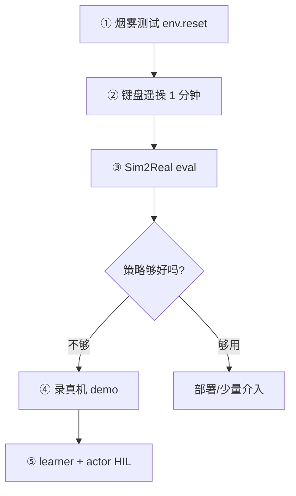

# 2026-06-22 · Manjaro 15fps 就绪后的下一步

## 当前进度

| 项 | 状态 |
|----|------|
| 机械臂 + 夹爪 SSH 隧道 | ✅ `smooth_teleop` 已验证 |
| 相机 Franka 对齐 + ROS 采图 | ✅ `RosImageCapture` + `config.py` |
| Manjaro 双路 **15fps** | ✅ 你刚确认 |
| 烟雾测试（Ubuntu 收图 + env reset） | ⬜ **下一步** |
| Sim2Real 评测 | ⬜ |
| 真机 demo / HIL 训练 | ⬜ |

---

## 第一步：端到端烟雾测试（今天必做）

目标：**不加载策略**，只验证「ROS 图 → env → 128×128 观测 → 机械臂连上」。

### 1.1 Manjaro（终端 A）

```bash
cd ~/workspace2025
source ./setup_ros2_humble.zsh
export ROS_DOMAIN_ID=42   # 与 Ubuntu 一致，数字自定

ros2 run myzed zed_camera_node
# 鱼眼若未随 zed 节点起来，另开终端：
# ros2 run v4l2_camera v4l2_camera_node --ros-args \
#   -p video_device:=/dev/video2 -p image_size:=[1280,720] ...
```

确认：

```bash
ros2 topic hz /zed/left/image_raw    # ≈15
ros2 topic hz /image_raw               # ≈15
```

### 1.2 Ubuntu（终端 B）— SSH 隧道

```bash
ssh -N -L 32085:<臂控IP>:8899 -L 32086:127.0.0.1:8765 Manjaro
```

### 1.3 Ubuntu（终端 C）— 烟雾脚本

```bash
source ~/hil-serl/.venv/bin/activate
export ROS_DOMAIN_ID=42
cd ~/hil-serl/examples/experiments/aubo_pick_cube_real
bash smoke_env.sh
```

**通过标准**：打印 `images front/wrist (128,128,3)`，OpenCV 窗口有画面，机械臂无异常。

**若 `ros2 topic list` 看不到 Manjaro topic**：先修 DDS（同网段、`ROS_DOMAIN_ID`、防火墙），**不要**先跑训练。

---

## 第二步：键盘遥操闭环（仍不训策略）

```bash
source ~/hil-serl/.venv/bin/activate
export ROS_DOMAIN_ID=42
export DISPLAY=:52.0
cd ~/hil-serl/examples

python -c "
from experiments.mappings import get_train_config
import numpy as np
cfg = get_train_config('aubo_pick_cube_real')
env = cfg.get_environment(fake_env=False)
obs, _ = env.reset()
print('Space=intervention, WASD/FR move, Enter=success, ESC=fail, q to quit')
act = np.zeros(7, np.float32)
for _ in range(500):
    obs, r, term, trunc, info = env.step(act)
    if term or trunc:
        obs, _ = env.reset()
env.close()
"
```

确认：Space 介入能控臂、`[`/`]` 夹爪、两路相机在窗口里更新。

---

## 第三步：Sim2Real 评测（仿真 checkpoint 上真机）

前提：仿真已有 checkpoint，例如 `checkpoints/aubo_pick_cube_sim_rsa`。

```bash
source ~/hil-serl/.venv/bin/activate
export ROS_DOMAIN_ID=42
cd ~/hil-serl/examples/experiments/aubo_pick_cube_real
bash run_eval.sh
# 可选: export CHECKPOINT_PATH=... EVAL_STEP=5000 EVAL_N_TRAJS=5
```

操作：**Space** 随时接管；看策略能否抓方块（成功率可能很低，属正常）。

---

## 第四步：按目标分叉

### 路径 A — 只想真机能用仿真策略（微调少）

1. Sim2Real eval 多试几个 checkpoint step  
2. 不行再录 **10–20 条真机 demo**，用仿真 demo + 真机 demo 混合 learner 微调  

### 路径 B — 真机 HIL 从头/继续训

| 顺序 | 动作 |
|------|------|
| 1 | `record_demos.py --exp_name=aubo_pick_cube_real --successes_needed=20`（Enter 标成功） |
| 2 | （建议）接 **reward classifier** — 当前真机 `reward=0`，在线 RL 缺自动 success |
| 3 | 终端1 learner（GPU）：`bash run_learner.sh` |
| 4 | 终端2 actor（真机）：`export LEARNER_IP=<GPU机IP>; bash run_actor.sh` |

脚本目录：`examples/experiments/aubo_pick_cube_real/`

| 脚本 | 作用 |
|------|------|
| `smoke_env.sh` | ROS + env.reset 烟雾测试 |
| `run_eval.sh` | Sim2Real 评测（默认加载 sim checkpoint） |
| `run_learner.sh` | GPU learner（demo 优先真机，否则回退 sim） |
| `run_actor.sh` | 真机 actor + 键盘 HIL |

---

## 建议优先级（置信度：高）



**你现在最该做的一件事**：完成 **第一步烟雾测试**。  
过了再 Sim2Real；不过则查 ROS 域或隧道，不要跳步。

---

## 待办（可选）

- 在 `config.py` 接入 `MultiCameraBinaryRewardClassifierWrapper`（真机在线 RL 需要）

---

## 检查清单（复制自用）

- [ ] Manjaro：`zed` + 鱼眼节点运行，`hz` ≈ 15  
- [ ] Ubuntu：`ROS_DOMAIN_ID` 与 Manjaro 相同，能 `ros2 topic hz`  
- [ ] SSH：32085 + 32086 隧道存活  
- [ ] 烟雾：`SMOKE OK`，图像 128×128  
- [ ] 键盘：intervention + 夹爪正常  
- [ ] Sim2Real：eval 跑通至少 1 个 episode  
