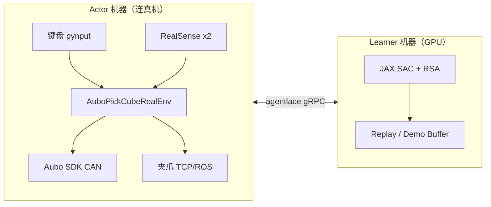
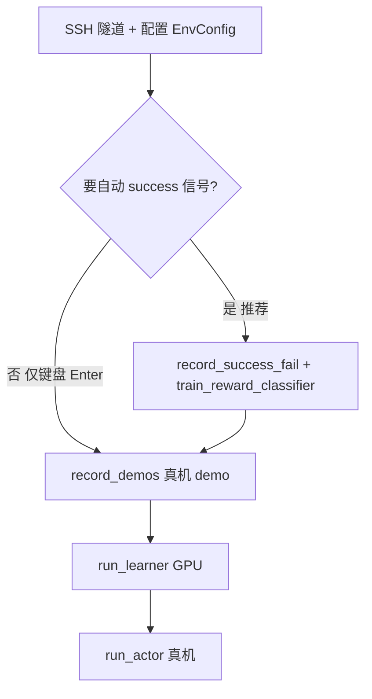

# 2026-06-22 · Aubo 真机上线路线图

## 结论（先说）

你当前 **`smooth_teleop` 已在跑**（`127.0.0.1:32085` + `Manjaro` SSH 夹爪），说明机械臂 CAN 与夹爪链路已通。  
上 HIL 真机分两条路，**建议按顺序做**：

| 阶段 | 目标 | 难度 | 前置 |
|------|------|------|------|
| **A. Sim2Real 评测** | 用仿真 checkpoint 在真机 rollout | 低 | 填相机序列号 + 改 `EnvConfig` |
| **B. 真机 HIL 训练** | actor 连真机、learner 在 GPU 上训 | 中高 | A 通过 + demo +（建议）reward classifier |

**当前缺口（置信度：高）**：`aubo_pick_cube_real` 只有 `config.py`，**没有** `run_actor.sh` / `run_learner.sh`；且 **reward classifier 尚未接入**（`classifier=True` 被 `del` 掉），真机 env 每步 `reward=0`，在线 RL 几乎收不到环境奖励。

---

## 1. 架构速览



与仿真相同：**actor / learner 双进程**，`train_rlpd.py` 的 `--actor` / `--learner`。  
区别：actor 侧 `fake_env=False`，直连 Aubo SDK + RealSense；learner 侧 `fake_env=True`，不碰机器人。

---

## 2. 上线前必改配置

文件：`examples/experiments/aubo_pick_cube_real/config.py` 里的 `EnvConfig`。

### 2.1 机械臂 + 夹爪（对齐你现在的 smooth_teleop）

你已在用：

```bash
python3 smooth_teleop.py \
  --no-ros \
  --robot-ip=127.0.0.1 --robot-port=32085 \
  --gripper-via-ssh=Manjaro
```

在 `EnvConfig` 中应写成（与 `examples/aubo_sysid_record.py --tunnel` 一致）：

```python
class EnvConfig(AuboRealEnvConfig):
    ROBOT_IP = "127.0.0.1"
    ROBOT_PORT = 32085

    USE_ROS_GRIPPER = False
    USE_TCP_GRIPPER = True
    GRIPPER_SSH_HOST = "Manjaro"
    GRIPPER_TCP_LOCAL_PORT = 32086
    GRIPPER_TCP_MANUAL_TUNNEL = False  # 若 SSH -L 已手动开好则 True

    REALSENSE_CAMERAS = { ... }  # 见下节
    IMAGE_CROP = {}
```

**保持 SSH 隧道常驻**（另开终端）：

```bash
ssh -N -L 32085:<机械臂控制器IP>:8899 -L 32086:127.0.0.1:8765 Manjaro
```

（端口以你实际为准；`smooth_teleop` 能连上即可照抄。）

### 2.2 RealSense 相机序列号

在 `aubo_control_config.py` 或 `EnvConfig.REALSENSE_CAMERAS` 填入真实序列号：

```bash
source ~/hil-serl/.venv/bin/activate
rs-enumerate-devices | grep Serial
```

| key | 用途 | 对应仿真 |
|-----|------|----------|
| `front` | 全局针孔 | `agentview` |
| `wrist` | 腕部广角/鱼眼 | `wrist_cam` |

`IMAGE_CROP` 可先留空，录 demo 时看 OpenCV 窗口再裁。

### 2.3 显示与虚拟环境

```bash
source ~/hil-serl/.venv/bin/activate
export DISPLAY=:52.0          # 与仿真 actor 相同；键盘必须在图形桌面焦点
export XLA_PYTHON_CLIENT_PREALLOCATE=false
```

---

## 3. 阶段 A：Sim2Real 评测（推荐第一步）

**目的**：不训练，只验证「仿真策略 + 真机执行 + 真机相机」是否闭环。

### 3.1 前提

- 阶段 2 配置已改好
- 已有仿真 checkpoint，例如 `checkpoints/aubo_pick_cube_sim_rsa`
- SSH 隧道 + smooth_teleop 同级连通性

### 3.2 命令

```bash
source ~/hil-serl/.venv/bin/activate
cd ~/hil-serl/examples

python train_rlpd.py \
  --exp_name=aubo_pick_cube_real \
  --checkpoint_path=~/hil-serl/checkpoints/aubo_pick_cube_sim_rsa \
  --actor \
  --eval_checkpoint_step=5000 \
  --eval_n_trajs=5
```

### 3.3 操作说明

| 键 | 作用 |
|----|------|
| **Space** | 切换 intervention（开=键盘控，关=策略控） |
| WASD / FR / IJKL / UO | 平移 / 旋转（intervention 时） |
| `[` `]` | 夹爪关 / 开 |
| `+` `-` | 调速度上限 |
| **Enter** | 标记本局成功（eval 计 success） |
| **ESC** | 标记失败并结束 |

**策略步频**：10 Hz；底层 CAN 100 Hz（与 `aubo_control_config.py` 一致）。

### 3.4 预期与风险

| 项 | 优势 | 风险 |
|----|------|------|
| Sim2Real | 最快验证整条链路 | 仿真/真机图像域差 → 成功率可能很低 |
| 速度 | 沿用 `MAX_LIN_VEL=0.02` m/s，较安全 | 仍建议旁站急停 |
| RPY | 策略步会把 `action[3:6]` 置零（防漂移） | 与仿真成功策略若依赖旋转，真机表现会变 |

---

## 4. 阶段 B：真机 HIL 训练

### 4.1 整体流程（对标 Franka walkthrough）



### 4.2 录 demonstration（真机）

```bash
source ~/hil-serl/.venv/bin/activate
cd ~/hil-serl/examples

python record_demos.py \
  --exp_name=aubo_pick_cube_real \
  --successes_needed=20
```

- 键盘图与仿真相同（见上表）。
- **Enter** = 成功并写入 demo；**ESC** = 失败。
- 输出：`demo_data/aubo_pick_cube_real_20_demos_<时间戳>.pkl`
- 也可**先用仿真 demo** 启动 learner（域迁移），再逐步换真机 demo。

### 4.3 Reward classifier（当前未接入，若要完整真机 RL 建议补）

Franka 任务流程（`docs/franka_walkthrough.md`）：

```bash
python record_success_fail.py --exp_name aubo_pick_cube_real --successes_needed 200
cd experiments/aubo_pick_cube_real   # 目录尚不存在，需在 config 里接 classifier wrapper
python ../../train_reward_classifier.py --exp_name aubo_pick_cube_real
```

**现状**：`aubo_pick_cube_real/config.py` 中 `del classifier`，没有 `MultiCameraBinaryRewardClassifierWrapper`。  
**影响**：训练时环境奖励恒为 0，只能靠 **离线 demo + 人工 intervention 轨迹** 学习；稀疏 Enter 成功信号不够用。

**置信度：高** — 真机长时间在线训练前，应接 classifier 或实现与仿真等价的 success 检测。

### 4.4 Learner（GPU 机）

`aubo_pick_cube_sim` 有 `run_learner.sh`，真机可照抄改 `exp_name` 与路径：

```bash
source ~/hil-serl/.venv/bin/activate
export XLA_PYTHON_CLIENT_PREALLOCATE=false
export XLA_PYTHON_CLIENT_MEM_FRACTION=0.3

CHECKPOINT_PATH=~/hil-serl/checkpoints/aubo_pick_cube_real_rsa
DEMO_PATH=~/hil-serl/demo_data/aubo_pick_cube_real_20_demos_XXXX.pkl  # 或仿真 demo

cd ~/hil-serl/examples
python train_rlpd.py \
  --exp_name=aubo_pick_cube_real \
  --checkpoint_path="${CHECKPOINT_PATH}" \
  --demo_path="${DEMO_PATH}" \
  --learner
```

### 4.5 Actor（真机侧）

```bash
source ~/hil-serl/.venv/bin/activate
export XLA_PYTHON_CLIENT_PREALLOCATE=false
export XLA_PYTHON_CLIENT_MEM_FRACTION=0.1
export DISPLAY=:52.0

# learner 若在另一台机器，把 localhost 换成 learner IP
LEARNER_IP=192.168.x.x

cd ~/hil-serl/examples
python train_rlpd.py \
  --exp_name=aubo_pick_cube_real \
  --checkpoint_path=~/hil-serl/checkpoints/aubo_pick_cube_real_rsa \
  --actor \
  --ip="${LEARNER_IP}"
```

训练时 **Space 随时介入**；初期建议多介入，与仿真 HIL 相同。

### 4.6 Checkpoint 命名（与 RSA 文档一致）

| 用途 | 路径 |
|------|------|
| 真机新训 | `checkpoints/aubo_pick_cube_real_rsa` |
| 从仿真 warm-start | learner 可 `--demo_path` 用仿真 pkl，checkpoint 仍建议新目录 |

---

## 5. 快速自检清单

在跑 `train_rlpd --actor` 之前逐项确认：

- [ ] `smooth_teleop` 同参数下能流畅遥操
- [ ] SSH `-L 32085` / `-L 32086` 隧道存活
- [ ] `EnvConfig` 已改 IP / 端口 / TCP 夹爪
- [ ] RealSense 序列号已填，`front` + `wrist` 均有画面
- [ ] `DISPLAY` 正确，OpenCV 窗口 `aubo_pick_cube_real` 能弹出
- [ ] 机械臂在 **pickup 工作位** 附近，桌上有方块
- [ ] 急停 / 碰撞等级（`COLLISION_CLASS=6`）已确认

**最小烟雾测试**（不加载 JAX 策略）：

```bash
source ~/hil-serl/.venv/bin/activate
cd ~/hil-serl/examples
python -c "
from experiments.mappings import get_train_config
cfg = get_train_config('aubo_pick_cube_real')
env = cfg.get_environment(fake_env=False)
obs, info = env.reset()
print('keys', obs.keys())
print('pixels', {k: v.shape for k,v in obs['pixels'].items()})
env.close()
print('OK')
"
```

---

## 6. 与仿真的关键差异

| 维度 | 仿真 `aubo_pick_cube_sim` | 真机 `aubo_pick_cube_real` |
|------|---------------------------|----------------------------|
| 执行 | MuJoCo mocap | Aubo SDK CAN + IK |
| 奖励 | `check_success()` 自动 | 默认 `reward=0` |
| 录 demo | `teleop_record` 自动开 intervention | 需手动 Space 或改 `record_demos.py` |
| 夹爪 | MuJoCo 关节 | ROS `gripper_setting` 或 TCP SSH |
| 启动脚本 | 有 `run_*.sh` | **需自建或用手写命令** |
| RSA | `rsa_image_keys=["wrist"]` | 同左 |

---

## 7. 推荐执行顺序（结合你当前状态）

1. **今天**：改 `EnvConfig`（tunnel + 相机）→ 烟雾测试 → **Sim2Real eval**（阶段 A）
2. **eval 能动起来后**：真机录 10–20 条 demo
3. **若要真机在线 RL 收敛**：先接 reward classifier，再 learner + actor 双开
4. **若 sim 策略 eval 已够用**：可直接在真机上微调（少量 intervention），不必从零训

---

## 8. 相关文件索引

| 文件 | 作用 |
|------|------|
| `examples/experiments/aubo_pick_cube_real/config.py` | 真机训练配置入口 |
| `serl_robot_infra/franka_env/envs/aubo_i10_real_env.py` | 真机 Gym 环境 |
| `serl_robot_infra/franka_env/envs/aubo_control_config.py` | 速度/键盘/相机默认值 |
| `serl_robot_infra/franka_env/envs/aubo_hil_wrappers.py` | 键盘 intervention |
| `python3.x/smooth_teleop.py` | 独立遥操（你已验证） |
| `examples/aubo_sysid_record.py --tunnel` | tunnel 预设参考 |
| `docs/2026-06-22_RSA重训命名建议.md` | checkpoint 命名 |
| `.specstory/history/2026-06-22_真机速度控制原理.md` | 速度控制五级链路 |

---

## 9. 若需要我下一步代做

可选（按优先级）：

1. 为 `aubo_pick_cube_real` 添加 `run_actor.sh` / `run_learner.sh` / `run_eval.sh`（mirror 仿真目录）
2. 在 `config.py` 接入 `MultiCameraBinaryRewardClassifierWrapper`
3. 把 `aubo_pick_cube_real` 加入 `record_demos.py` 的 `teleop_record` 集合

告知要做哪一项即可。
