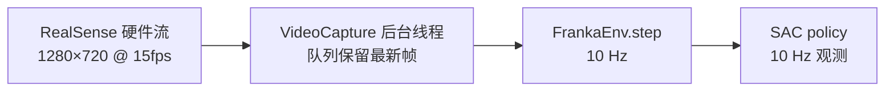

# 2026-06-22 · FrankaEnv 双相机分辨率与帧率

## 结论

HIL-SERL 里 Franka 真机实验的 RealSense **采集流**统一为：

| 项目 | 值 | 依据 |
|------|-----|------|
| **分辨率（每路 color）** | **1280 × 720**（宽 × 高） | 各实验 `EnvConfig.REALSENSE_CAMERAS` 的 `dim: (1280, 720)` |
| **帧率（相机硬件流）** | **15 fps** | 配置里**未写 `fps`** → `RSCapture` 默认 `fps=15` |
| **送入策略的图像** | **128 × 128** RGB | `FrankaEnv` 里 `cv2.resize` + `observation_space` |
| **策略步频（读图频率）** | **10 Hz** | `FrankaEnv(hz=10)`，每步 `sleep` 对齐，**不是** 15fps 逐步对齐 |

两路相机参数**对称**：`wrist_1` / `wrist_2` 用同一套 `dim`，仅 `serial_number`、`exposure`、`IMAGE_CROP` 不同。

---

## 1. 采集层：`RSCapture`

```10:18:serl_robot_infra/franka_env/camera/rs_capture.py
    def __init__(self, name, serial_number, dim=(640, 480), fps=15, depth=False, exposure=40000):
        ...
        self.cfg.enable_stream(rs.stream.color, dim[0], dim[1], rs.format.bgr8, fps)
```

- 默认 `dim=(640, 480)`、`fps=15` 仅在**未在 config 里覆盖**时生效。
- Franka 论文实验 config **都显式写了 `dim=(1280, 720)`**，**没有写 `fps`**，故实际为 **15fps**。

---

## 2. 实验 config 实例（双腕相机）

### RAM insertion（典型双腕）

```23:33:examples/experiments/ram_insertion/config.py
    REALSENSE_CAMERAS = {
        "wrist_1": {
            "serial_number": "127122270146",
            "dim": (1280, 720),
            "exposure": 40000,
        },
        "wrist_2": {
            "serial_number": "127122270350",
            "dim": (1280, 720),
            "exposure": 40000,
        },
    }
```

### USB pickup（双腕 + 侧视，腕部同样 1280×720）

```23:33:examples/experiments/usb_pickup_insertion/config.py
        "wrist_1": { ..., "dim": (1280, 720), "exposure": 10500 },
        "wrist_2": { ..., "dim": (1280, 720), "exposure": 10500 },
```

### Egg flip（`FrankaWrenchEnv` 默认）

```56:66:serl_robot_infra/franka_env/envs/franka_wrench_env.py
    REALSENSE_CAMERAS: Dict = {
        "wrist_1": { "serial_number": "...", "dim": (1280, 720), "exposure": 7000 },
        "side":      { "serial_number": "...", "dim": (1280, 720), "exposure": 7000 },
    }
```

---

## 3. 策略看到的分辨率：128×128

```148:151:serl_robot_infra/franka_env/envs/franka_env.py
                "images": gym.spaces.Dict(
                    {key: gym.spaces.Box(0, 255, shape=(128, 128, 3), dtype=np.uint8) 
                                for key in config.REALSENSE_CAMERAS}
```

`get_im()` 流程：RealSense 原图 →（可选）`IMAGE_CROP` → **resize 到 128×128** → BGR 转 RGB 写入 `obs["images"]`。

---

## 4. 两层「帧率」不要混



| 层级 | 频率 | 含义 |
|------|------|------|
| RealSense `fps` | **15** | `pyrealsense2` color stream |
| `FrankaEnv.hz` | **10** | 机械臂控制 + `step()` 调用间隔 |
| 实际进 policy 的图 | **≤10 Hz** | 每步从队列取**当前最新一帧**，可能跳过中间 15fps 帧 |

---

## 5. 与 Aubo 配置的对比（供你对齐真机）

`aubo_control_config.py` 里同样写了 `dim: (1280, 720)`、`exposure: 40000`，且未写 `fps` → 若走 RealSense 后端，也是 **1280×720 @ 15fps**，策略侧 **128×128 @ 10Hz**。

你的 ZED/鱼眼是 **720p / 30fps** 与 **1280×1024** 等，和 Franka 默认并不相同；对接时需单独定采集分辨率与是否仍 resize 到 128×128。
