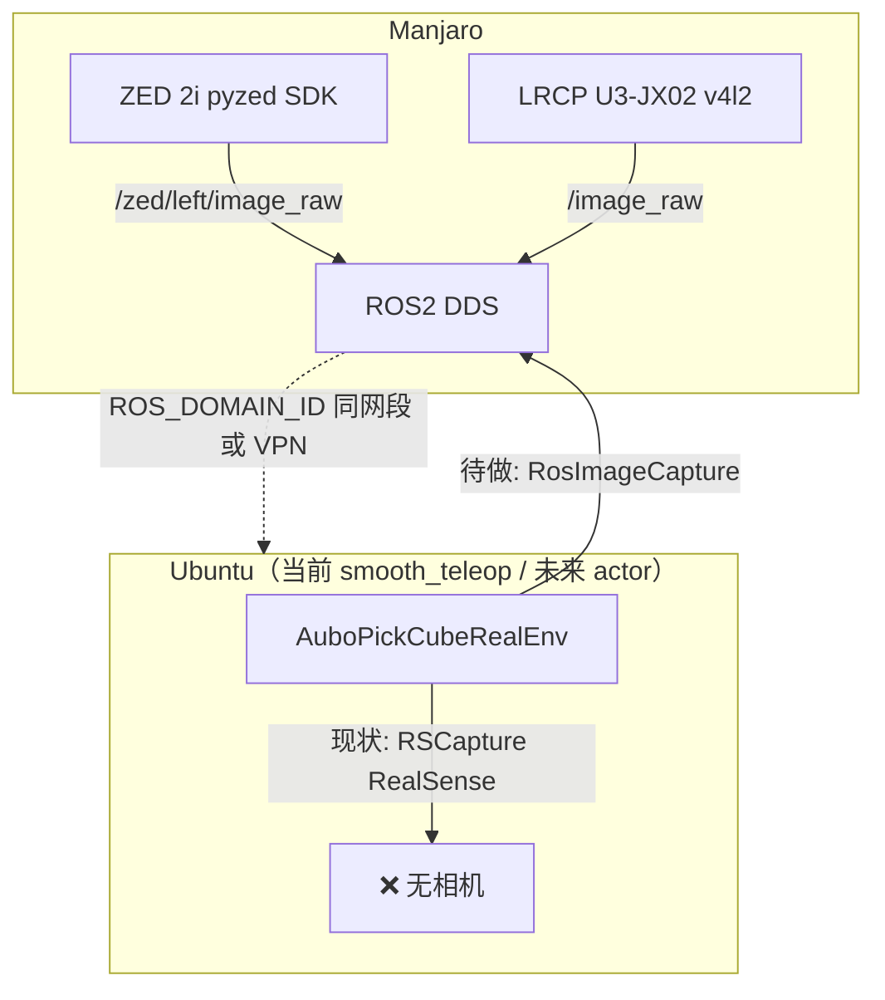

# 2026-06-22 · Manjaro 相机拓扑（ZED 2i + LRCP 鱼眼）

## 结论

你的真机相机**不是 RealSense**，而是接在 **Manjaro（`ningyv`）** 上：

| hil-serl key        | 硬件                                          | 设备节点                         | ROS2 topic（节点启动后） | 仿真对应           |
| ------------------- | --------------------------------------------- | -------------------------------- | ------------------------ | ------------------ |
| **`front`** | Stereolabs**ZED 2i**（SN `39776981`） | `/dev/video0`、`/dev/video1` | `/zed/left/image_raw`  | `agentview` 针孔 |
| **`wrist`** | **LRCP U3-JX02** 鱼眼                   | `/dev/video2`、`/dev/video3` | `/image_raw`           | `wrist_cam` 广角 |

**当前 hil-serl 真机 env 只支持 Intel RealSense（`RSCapture` + `pyrealsense2`）**，不能直接填 serial number 跑起来。需要改为 **订阅 Manjaro 上的 ROS 图像 topic**（或把 actor 搬到 Manjaro 本地采图）。

---

## 1. SSH 到 Manjaro 要查什么

### 1.1 一键盘点（已在你机器上跑过）

```bash
ssh Manjaro

# USB 与 V4L2 设备名
lsusb | grep -iE "zed|stereo"
ls -la /dev/video*
for d in /dev/video*; do
  echo "=== $d ==="
  v4l2-ctl -d $d --info | grep -E "Card type|Bus info"
done
```

**实测结果（2026-06-22）**：

```
Bus 002 Device 006: ID 2b03:f880 STEREOLABS ZED 2i
/dev/video0, /dev/video1  →  Card type: ZED 2i: ZED 2i
/dev/video2, /dev/video3  →  Card type: LRCP U3-JX02: LRCP U3-JX02
```

鱼眼支持 **1280×1024 MJPEG**，最高约 200fps（`v4l2-ctl -d /dev/video2 --list-formats-ext`）。

### 1.2 ROS2 图像 topic（需先启动相机节点）

```bash
ssh Manjaro
source ~/workspace2025/setup_ros2_humble.zsh

# 终端 1：ZED +（可选）鱼眼 v4l2
ros2 run myzed zed_camera_node

# 终端 2：确认 topic
ros2 topic list | grep -E "image|zed"
ros2 topic hz /zed/left/image_raw
ros2 topic hz /image_raw
ros2 topic echo /zed/left/image_raw --once | head -5
```

**与现有 recorder 默认一致**（`my_aubo_recorder.py`）：

- `image_topic` = `/zed/left/image_raw` → **front**
- `wrist_topic` = `/image_raw` → **wrist**

### 1.3 看一帧画面（Manjaro 有显示器时）

```bash
source ~/workspace2025/setup_ros2_humble.zsh
e
# 分别选 /zed/left/image_raw 和 /image_raw
```

或用你 workspace 里的双相机 perspective：`myzed/my_2_cameras.perspective`。

---

## 2. Manjaro 上相机节点怎么起

`inspire_gripper/README.md` 里的现实采集顺序：

```bash
cd ~/workspace2025
source ./setup_ros2_humble.zsh

# 1. 机械臂 driver（若需要）
# 2. ZED 节点（会尝试顺带起 v4l2 鱼眼）
ros2 run myzed zed_camera_node

# 3. 夹爪（你 Ubuntu 侧 smooth_teleop 已在用）
# inspire_gripper_service 当前在 Manjaro 上已在跑
```

### ZED 节点细节

- 脚本：`~/workspace2025/src/myzed/myzed/zed_camera_node.py`
- 依赖：`pyzed.sl`（在 `ros2_humble` conda 里，**不是**系统 `python3`）
- 发布：左目校正 RGB **1280×720**（`HD720` @ 30fps）到 `/zed/left/image_raw`
- ZED SDK 路径：`/usr/local/zed/`，标定 `SN39776981.conf`

### 鱼眼 v4l2 节点

- 包：`v4l2_camera`
- 默认发布：`/image_raw` + `/camera_info`
- 标定文件：`~/workspace2025/config/ny_fisheye_calibration.yaml`（`camera_name: lrcp_u3-jx02`）

### ⚠️ 代码里可能的设备号错误

`zed_camera_node.py` 里 subprocess 启动 v4l2 时写的是：

```text
-p video_device:=/dev/video0
```

但 **`/dev/video0` 是 ZED**，鱼眼应在 **`/dev/video2`**。若你发现 `/image_raw` 和 ZED 画面一样，或鱼眼无图，在 Manjaro 上应改为：

```bash
ros2 run v4l2_camera v4l2_camera_node --ros-args \
  -p video_device:=/dev/video2 \
  -p image_size:=[1280,1024] \
  -p pixel_format:=MJPG \
  -p camera_info_url:=file:///home/ningyv/workspace2025/config/ny_fisheye_calibration.yaml
```

（`pixel_format` 以 `v4l2-ctl --list-formats-ext` 为准；上面实测鱼眼支持 MJPG。）

---

## 3. 与 hil-serl 的映射关系



| 项目         | 仿真                          | 你真机（Manjaro）                            |
| ------------ | ----------------------------- | -------------------------------------------- |
| front 分辨率 | 渲染任意 → 128×128          | ZED 左目 1280×720 → env 内 resize 128×128 |
| wrist 分辨率 | 鱼眼 FOV 130°                | LRCP 1280×1024 鱼眼 → resize 128×128      |
| RSA          | `rsa_image_keys=["wrist"]`  | 仍应对**wrist（鱼眼）** 开 RSA         |
| classifier   | `classifier_keys=["front"]` | 建议仍用**ZED 全局图**                 |

---

## 4. 你现在不能直接用 `REALSENSE_CAMERAS` 的原因

`aubo_i10_real_env.py` 的 `_init_cameras()`：

```python
for key, cfg in self.config.REALSENSE_CAMERAS.items():
    rs = RSCapture(name=key, **cfg)  # pyrealsense2，只认 RealSense 序列号
```

Manjaro 上 **没有 RealSense USB 设备**，在 Ubuntu 上跑 actor 也 **看不到** ZED/鱼眼的 V4L2 节点。

---

## 5. 三条可行对接路线

### 路线 A（推荐）：ROS 图像订阅 + actor 在 Ubuntu

1. Manjaro 常驻：`zed_camera_node` + `v4l2_camera_node`（鱼眼用 `/dev/video2`）
2. Ubuntu 与 Manjaro **同一 `ROS_DOMAIN_ID`**，能 `ros2 topic list` 看到上述 topic
3. 在 hil-serl 增加 `RosImageCapture`（订阅 `sensor_msgs/Image`，cv_bridge 转 BGR numpy），替换 `RSCapture`
4. `EnvConfig` 改为 topic 字典，例如：

```python
ROS_IMAGE_CAMERAS = {
    "front": "/zed/left/image_raw",
    "wrist": "/image_raw",
}
```

**优势**：机械臂隧道、键盘、JAX actor 仍在你熟悉的 Ubuntu 桌面。
**风险**：跨机 ROS 延迟与 DDS 配置（防火墙、domain id）。

### 路线 B：actor 整机跑在 Manjaro

- 相机本地 pyzed + v4l2，无跨机图像
- 机械臂 SDK 若也在 Manjaro 本机网段，可不用 SSH 隧道
- learner 仍在 Ubuntu GPU，`--ip` 指向 learner

**优势**：图像链路最简单。
**风险**：Manjaro 上要装 JAX/CUDA、DISPLAY 键盘干预。

### 路线 C：轻量图像 TCP/HTTP 桥（类似 gripper_tcp_bridge）

- Manjaro 小进程：订阅 ROS → JPEG base64 → localhost port
- Ubuntu SSH `-L` 转发图像端口

**优势**：不依赖跨机 ROS。
**风险**：要自己写桥，延迟与同步需调。

---

## 6. 在 Manjaro 上的最小验收清单

跑 hil-serl 真机前，在 Manjaro 单独确认：

- [ ] `lsusb` 能看到 ZED 2i + LRCP
- [ ] `ros2 run myzed zed_camera_node` 无报错，`ros2 topic hz /zed/left/image_raw` ≈ 30Hz
- [ ] 鱼眼 `v4l2` 用 **`/dev/video2`**，`ros2 topic hz /image_raw` 有稳定帧率
- [ ] `rqt_image_view` 两路画面内容正确（全局场景 + 腕部鱼眼）
- [ ] 若 Ubuntu 要收图：`export ROS_DOMAIN_ID=同值` 后在 Ubuntu `ros2 topic list` 能看到上述 topic

---

## 7. 与仿真实机文档的修正

[`docs/2026-06-22_Aubo真机上线路线图.md`](./2026-06-22_Aubo真机上线路线图.md) 里「填 RealSense 序列号」一节 **不适用于你的硬件**；应改为：

1. Manjaro 起 ZED + 鱼眼 ROS 节点
2. 实现/启用 ROS 采图后端
3. `front`/`wrist` key 保持不变（与仿真 checkpoint 结构兼容）

---

## 8. 建议的下一步

1. **你今天在 Manjaro**：按 §1.2 起节点，确认两路 topic 有图；必要时修正 `video_device` → `/dev/video2`
2. **把 `ros2 topic list` + `ros2 topic hz` 输出贴回来**，便于定 DDS/跨机是否通
3. **若你同意改代码**：我可以加 `RosImageCapture` + `EnvConfig.ROS_IMAGE_CAMERAS`，让 `aubo_pick_cube_real` 走 Manjaro topic 而不是 RealSense

---

## 附录：相关仓库文件

| 位置                                                   | 作用                                  |
| ------------------------------------------------------ | ------------------------------------- |
| `~/workspace2025/src/myzed/myzed/zed_camera_node.py` | ZED →`/zed/left/image_raw`         |
| `~/workspace2025/src/v4l2_camera/`                   | 鱼眼 UVC →`/image_raw`             |
| `~/workspace2025/config/ny_fisheye_calibration.yaml` | 鱼眼标定（当前矩阵多为 0，待填实）    |
| `python3.x/.../my_aubo_recorder.py`                  | 默认 topic 映射参考                   |
| `serl_robot_infra/franka_env/camera/rs_capture.py`   | 当前真机用的 RealSense 后端（需扩展） |
