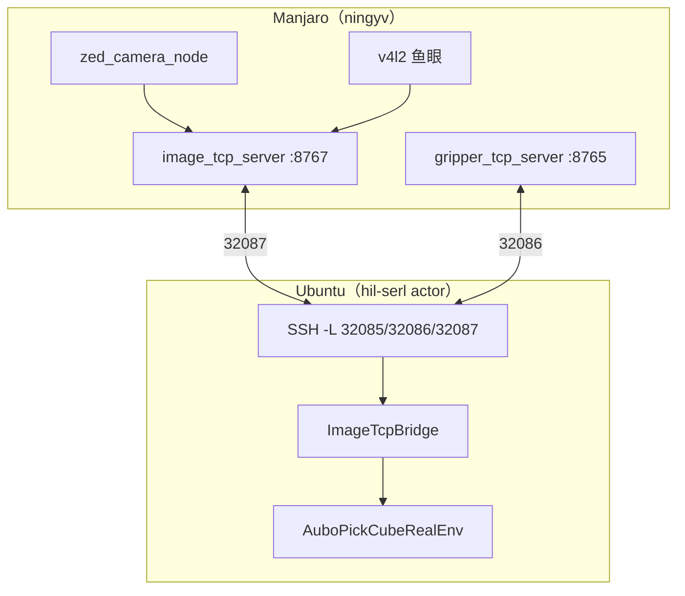

# 2026-06-22 · Manjaro / Ubuntu 分工（真机取图）

## 原则

| 机器 | 职责 | 需要 ROS2? |
|------|------|------------|
| **Manjaro** | 相机硬件、ROS 节点、TCP 服务（臂侧/夹爪/图像） | **是** |
| **Ubuntu** | hil-serl 训练/actor、Aubo SDK 隧道、JPEG 客户端 | **否** |

**Manjaro 上没有 `~/hil-serl`**（已 SSH 核实）。Manjaro 侧脚本放在 **`~/workspace2025/src/inspire_gripper/`**，与 `gripper_tcp_server.py` 同级。

Ubuntu 上改代码 → **`scp` 部署到 Manjaro** → 再跑 smoke。

---

## 文件归属一览

### 只跑在 Manjaro

| 文件（Manjaro 路径） | 作用 |
|----------------------|------|
| `~/workspace2025/src/inspire_gripper/image_tcp_server.py` | ROS 订阅 ZED/鱼眼 → JPEG TCP **:8767** |
| `~/workspace2025/src/inspire_gripper/gripper_tcp_server.py` | 夹爪 TCP **:8765**（已有） |
| `ros2 run myzed zed_camera_node` | ZED → `/zed/left/image_raw` |
| `ros2 run v4l2_camera v4l2_camera_node` … | 鱼眼 → `/image_raw`（设备 `/dev/video2`） |

### 只跑在 Ubuntu（hil-serl 仓库）

| 文件 | 作用 |
|------|------|
| `python3.x/image_tcp_bridge.py` | SSH 拉起 Manjaro server + 本地 **:32087** 隧道 |
| `python3.x/image_tcp_server.py` | **开发用副本**；改完需 deploy 到 Manjaro |
| `serl_robot_infra/.../tcp_capture.py` | TCP 客户端 |
| `serl_robot_infra/.../aubo_i10_real_env.py` | 真机 Gym |
| `examples/experiments/aubo_pick_cube_real/*` | config、run_*.sh、smoke |

### 两边都有、但路径不同

| 角色 | Ubuntu（开发） | Manjaro（运行） |
|------|----------------|-----------------|
| 图像 TCP 服务 | `hil-serl/python3.x/image_tcp_server.py` | `~/workspace2025/src/inspire_gripper/image_tcp_server.py` |

---

## 部署流程（改 Manjaro 侧代码时）

```bash
# 在 Ubuntu
cd ~/hil-serl/examples/experiments/aubo_pick_cube_real
bash deploy_manjaro_image_server.sh
```

等价于：

```bash
scp ~/hil-serl/python3.x/image_tcp_server.py \
  Manjaro:~/workspace2025/src/inspire_gripper/image_tcp_server.py
```

**当前状态**：已 scp 一次（2026-06-22），Manjaro 上文件存在。

---

## 运行时拓扑



| 端口 | 方向 | 用途 |
|------|------|------|
| 32085 | Ubuntu→Manjaro→臂控 | Aubo SDK |
| 32086 | 夹爪 TCP 隧道 | Inspire 夹爪 |
| 32087 | 图像 TCP 隧道 | front/wrist JPEG |

图像隧道由 `ImageTcpBridge.start()` **自动**建立（与夹爪 bridge 相同）；臂隧道需你手动 `ssh -N -L 32085:...`。

---

## Manjaro 日常启动（终端 A）

```bash
cd ~/workspace2025
source ./setup_ros2_humble.zsh

# 相机（15fps 已调好）
ros2 run myzed zed_camera_node
# 鱼眼若未随 zed 起来，另开终端 v4l2 @ /dev/video2

# image_tcp_server 可由 Ubuntu smoke/actor 经 SSH 自动启动；
# 手动调试：
python3 ~/workspace2025/src/inspire_gripper/image_tcp_server.py \
  127.0.0.1 8767 f:/zed/left/image_raw w:/image_raw
```

## Ubuntu 日常启动（终端 B/C）

```bash
# B: 臂隧道（若未开）
ssh -N -L 32085:<臂控IP>:8899 Manjaro

# C: 烟雾 / actor
source ~/hil-serl/.venv/bin/activate
cd ~/hil-serl/examples/experiments/aubo_pick_cube_real
bash smoke_env.sh
```

---

## 配置入口（Ubuntu 改）

`examples/experiments/aubo_pick_cube_real/config.py` → `EnvConfig`：

```python
IMAGE_TCP_SERVER_SCRIPT = "~/workspace2025/src/inspire_gripper/image_tcp_server.py"  # Manjaro 路径
USE_TCP_IMAGES = True
ROS_IMAGE_CAMERAS = {}   # Ubuntu 不装 ROS2 时保持空
```

---

## 易错点

1. **不要把 `~/hil-serl/...` 当 Manjaro 路径** — 那边没有此目录。  
2. **改 `image_tcp_server.py` 后忘记 scp** — Ubuntu smoke 仍拉起 Manjaro 旧文件。  
3. **Manjaro 相机节点未起** — TCP 连得上但 JPEG 长度为 0。  
4. **夹爪与图像各用独立 TCP 服务** — 勿与 `gripper_tcp_server` 混为一个进程。

---

## 相关脚本

| 脚本 | 在哪跑 |
|------|--------|
| `deploy_manjaro_image_server.sh` | Ubuntu |
| `smoke_env.sh` | Ubuntu |
| `run_actor.sh` / `run_eval.sh` | Ubuntu |
| `run_learner.sh` | Ubuntu（GPU，无机器人） |
