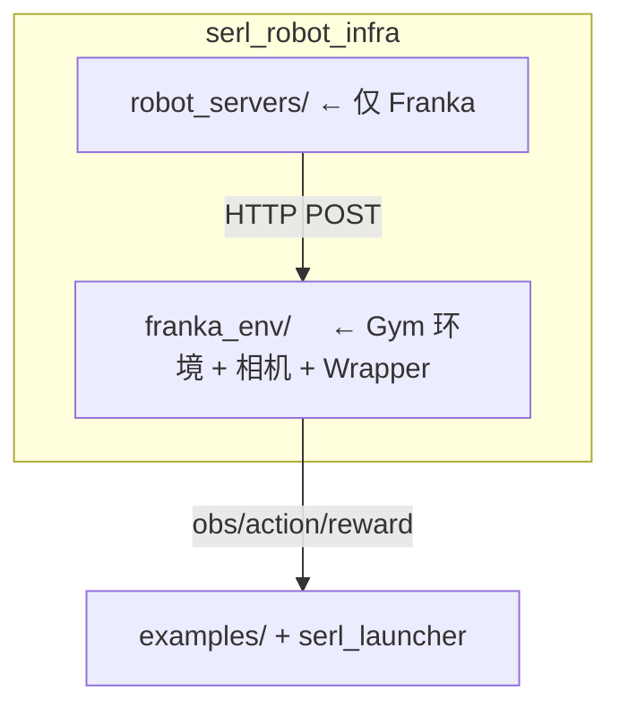
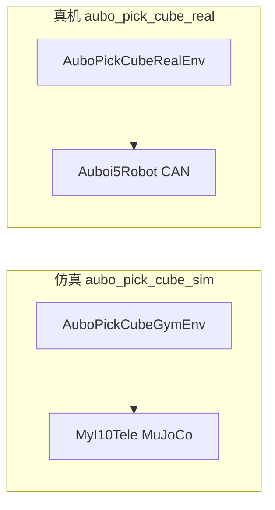

# 2026-06-22 · serl_robot_infra 架构讲解

> 目的：在你描述自己的 ZED + 鱼眼 + Manjaro 拓扑之前，先对齐 **hil-serl 里「机器人基础设施层」在做什么、怎么做**。下文基于当前仓库代码，不编造未实现能力。

---

## 1. 它是什么（第一性原理）

**`serl_robot_infra` 的唯一职责**：把「真实或仿真的机器人 + 相机」包装成 **Gymnasium 环境**，输出格式能被 `serl_launcher`（SAC、replay buffer、RSA 等）和 `examples/train_rlpd.py` 直接消费。

它不训练策略、不管 JAX；它解决的是：

$$
\text{policy 动作 } a_t \;\Rightarrow\; \text{硬件执行} \;\Rightarrow\; \text{观测 } o_{t+1} = \{\text{images}, \text{state}\}
$$

以及 HIL 所需的 **人工介入、奖励信号、episode 终止**。

安装方式：`pip install -e serl_robot_infra`（见根目录 `README.md`）。

---

## 2. 包内两大块



| 目录 | 干什么 | 谁在用 |
|------|--------|--------|
| **`robot_servers/`** | 在**实时控制 PC** 上跑 Flask + ROS，把 Franka 阻抗控制暴露成 HTTP API | Franka 真机（RAM/USB 等实验） |
| **`franka_env/`** | 定义 `gym.Env`、相机采集、通用 Wrapper、Aubo 扩展 | 所有实验的 `config.get_environment()` |

> **名字历史**：目录叫 `franka_env`，但你们已在这里加了 **Aubo i10 仿真 + 真机** 全套代码；Franka 是论文原版路径，Aubo 是后接路径。

---

## 3. 原版 Franka 链路（论文默认）

这是 README / `docs/franka_walkthrough.md` 描述的「标准形态」，理解它有助于对比你的 Aubo。

### 3.1 三层分离

```mermaid
sequenceDiagram
  participant Actor as train_rlpd actor
  participant Gym as FrankaEnv
  participant Flask as franka_server
  participant ROS as ROS 阻抗控制
  participant Arm as Franka 机械臂
  participant Cam as RealSense USB

  Actor->>Gym: step(action)
  Gym->>Flask: POST /pose, /open_gripper ...
  Flask->>ROS: 发布 equilibrium_pose
  ROS->>Arm: 力控跟踪
  Gym->>Cam: RSCapture.read() 本地 USB
  Gym-->>Actor: obs, reward, done
```

1. **`franka_server.py`**（独立进程）  
   - 启动 ROS `impedance.launch`  
   - Flask 提供 `/pose`、`/getstate`、`/jointreset`、`/close_gripper` 等（见 `serl_robot_infra/README.md` 表格）

2. **`FrankaEnv`**（`franka_env/envs/franka_env.py`）  
   - 通过 `requests.post(SERVER_URL + ...)` 控臂  
   - **相机在跑 Gym 的同一台机器上**，用 `pyrealsense2` 直连  
   - 10 Hz 策略步；动作 7D：$\Delta xyz$、$\Delta rotvec$、gripper  
   - 奖励：与 `TARGET_POSE` 比较（pose threshold），或外包 `MultiCameraBinaryRewardClassifierWrapper`

3. **实验 `config.py`**（如 `ram_insertion`）再叠 Wrapper 栈：

```text
RAMEnv(FrankaEnv 子类)
  → GripperCloseEnv
  → SpacemouseIntervention      # 3D 鼠标 HIL
  → RelativeFrame               # 相对坐标系
  → Quat2EulerWrapper
  → SERLObsWrapper              # serl_launcher：挑 proprio_keys
  → ChunkingWrapper
  → MultiCameraBinaryRewardClassifierWrapper  # classifier=True 时
```

### 3.2 Franka 观测格式（进 `SERLObsWrapper` 之前）

```python
obs = {
  "state": {
    "tcp_pose": (7,)   # xyz + quat
    "tcp_vel": (6,),
    "gripper_pose": (1,),
    "tcp_force": (3,),
    "tcp_torque": (3,),
  },
  "images": {
    "wrist_1": (128, 128, 3),
    "wrist_2": (128, 128, 3),
  }
}
```

### 3.3 相机子系统（Franka 与 Aubo 真机共用同一套类）

| 类 | 文件 | 作用 |
|----|------|------|
| **`RSCapture`** | `camera/rs_capture.py` | `pyrealsense2` 打开指定 **serial_number**，曝光、分辨率 |
| **`VideoCapture`** | `camera/video_capture.py` | 后台线程读相机，**队列只保留最新帧**（避免 policy 读到陈旧图） |
| **`MultiVideoCapture`** | `camera/multi_video_capture.py` | 多路同步（少用） |

env 内典型用法：

```python
cap = VideoCapture(RSCapture(name=key, serial_number=..., dim=(1280,720), exposure=40000))
rgb = cap.read()
resized = cv2.resize(crop(rgb), (128, 128))
```

**边界**：只支持 Intel RealSense；**没有** ZED / ROS topic / V4L2 后端。

---

## 4. 通用 Wrapper 层（`franka_env/envs/wrappers.py`）

与具体机器人无关、Franka 实验大量使用的组件：

| Wrapper | 做什么 |
|---------|--------|
| **`SpacemouseIntervention`** | 读 SpaceMouse；有输入则覆盖 policy 动作，写 `info["intervene_action"]` |
| **`MultiCameraBinaryRewardClassifierWrapper`** | 每步用 JAX 分类器对 **images** 打分 → `reward ∈ {0,1}`，`done=True` |
| **`Quat2EulerWrapper`** | `tcp_pose` 四元数 → 欧拉角（与策略维度对齐） |
| **`RelativeFrame`** | 位姿转到相对帧 |
| **`GripperCloseEnv` / `GripperPenaltyWrapper`** | 夹爪语义、惩罚 |

**HIL 数据流关键**：`train_rlpd.py` actor 里若 `info` 含 `intervene_action`，该步动作为人类动作，并额外写入 `intvn_data_store`（demo buffer）。

---

## 5. Aubo 扩展（你们仓库里新增的）

Aubo 路径**没有走** `robot_servers` Flask；机械臂控制在 **Gym 进程内** 直接调 `python3.x/robotcontrol.py`（Auboi5Robot SDK）。

### 5.1 两条环境线



| | **仿真** `aubo_i10_gym_env.py` | **真机** `aubo_i10_real_env.py` |
|--|-------------------------------|--------------------------------|
| 物理 | MuJoCo + `AuboMujocoController` | SDK `enter_tcp2canbus_mode` + IK |
| 动作语义 | 7D 归一化速度 + gripper | 同左（对齐 `smooth_teleop.py`） |
| 策略 Hz | 10 Hz | 10 Hz |
| 底层 | 100 Hz 仿真子步 | 100 Hz CAN 子步（`CAN_SUBSTEPS_PER_POLICY_STEP=10`） |
| 相机 | MuJoCo 渲染 `pixels` | **RSCapture RealSense**（待你改成 ROS） |
| 奖励 | `check_success()` 几何判定 | 默认 **恒 0**（无 classifier） |

共享参数：`aubo_control_config.py`（速度上限、键盘映射、`IMAGE_KEY_FRONT/WRIST`、episode 长度等）。

共享速度数学：`aubo_velocity_control.py` 的 `AuboVelocityIntegrator`：

$$
v_{\text{filt}} \leftarrow \alpha v_{\text{cmd}} + (1-\alpha) v_{\text{filt}}, \quad
p \leftarrow p + v_{\text{filt}} \cdot dt
$$

### 5.2 Aubo 专用 Wrapper（`aubo_hil_wrappers.py`）

| Wrapper | 作用 |
|---------|------|
| **`AuboKeyboardController`** | pynput 键盘；与 MyI10Tele `0.tele.py` 同键位 |
| **`AuboKeyboardWrapper`** | Space 切换 intervention；Enter/ESC 结束 episode |
| **`AuboObsWrapper`** | `pixels` → hil-serl 标准 `images` + `state` |
| **`AuboTeleopDisplayWrapper`** | OpenCV 拼 front/wrist/teleop 画面 |
| **`AuboHilInterventionInfoWrapper`** | `teleop_action` → `intervene_action` |
| **`AuboGripperPenaltyWrapper`** | 仿真夹爪惩罚（真机 config 未用） |

真机 `state` 由 `build_aubo_state_from_sdk(robot, gripper)` 从 SDK waypoint 构造（`tcp_pose` 为 xyz+rpy，**6 维**——与仿真里 rpy 置零的约定略有不同，训练时靠 `proprio_keys` 选取）。

### 5.3 真机夹爪（在 env 内，非 Flask）

`AuboRealEnvConfig` 三选一：

| 模式 | 配置 | 实现 |
|------|------|------|
| ROS service | `USE_ROS_GRIPPER=True` | `rclpy` 调 `gripper_setting` |
| TCP SSH | `USE_TCP_GRIPPER=True` | `python3.x/gripper_tcp_bridge.py` → Manjaro |
| 无夹爪 | 两者 False | 不调夹爪 |

这与 `smooth_teleop --gripper-via-ssh=Manjaro` 是同一套桥。

### 5.4 实验 config 如何拼装（`examples/experiments/*/config.py`）

**`serl_robot_infra` 不决定最终环境**；它提供积木。每个实验的 `TrainConfig.get_environment()` 负责：

1. 实例化底层 `Env`（`FrankaEnv` / `AuboPickCubeRealEnv` / 任务子类）
2. 叠 Wrapper（键盘 / SpaceMouse / classifier / 显示）
3. 最后 **`SERLObsWrapper` + `ChunkingWrapper`**（来自 `serl_launcher`）

`examples/mappings.py` 把 `exp_name` 懒加载到对应 `TrainConfig`。

---

## 6. 与上层 `train_rlpd.py` 的接口契约

| 角色 | `fake_env` | 需要硬件 |
|------|------------|----------|
| **learner** | `True` | 否（只要 `observation_space` / `action_space` 形状对） |
| **actor** | `False` | 是（机器人 + 相机 + 可选键盘 DISPLAY） |

actor 循环核心：

```text
action = policy(obs) 或 random 或 intervene_action
env.step(action) → transition 写入 replay / intervention buffer
```

**reward 来源**（因实验而异）：

| 来源 | 典型场景 |
|------|----------|
| env 几何判定 | Aubo 仿真 `check_success` |
| pose threshold | Franka `FrankaEnv.compute_reward` |
| 学习分类器 | Franka 真机 `MultiCameraBinaryRewardClassifierWrapper` |
| 键盘 Enter | Aubo `AuboKeyboardWrapper` |
| 恒 0 | **当前 Aubo 真机默认** |

---

## 7. 依赖与物理部署假设

`setup.py` 声明的主要依赖：

- `gymnasium`, `opencv-python`, `pyrealsense2`, `requests`, `flask`
- `pyspacemouse`, `hidapi`（Franka HIL）
- `scipy`, `pyquaternion`（位姿）

**隐含部署假设（原版 Franka）**：

- RealSense USB 插在 **跑 actor 的机器** 上
- Franka 控制 PC 与 actor 可 HTTP 互通
- ROS 只在 `robot_servers` 进程

**你们 Aubo 现状**：

- 机械臂 SDK 经 **SSH 隧道**（`127.0.0.1:32085`）
- 夹爪经 **SSH TCP 桥**（Manjaro）
- 相机在 **Manjaro**（ZED + 鱼眼 ROS），**不满足** RealSense 本地 USB 假设 → 这是接下来要写代码的核心缺口

---

## 8. 模块地图（非 history 的有效文件）

```text
serl_robot_infra/
├── setup.py
├── README.md                          # Franka 安装与 HTTP API
├── robot_servers/
│   ├── franka_server.py               # Flask + ROS 阻抗
│   ├── franka_gripper_server.py
│   └── launch_*_server.sh
└── franka_env/
    ├── camera/
    │   ├── rs_capture.py              # ★ 当前唯一相机驱动
    │   └── video_capture.py           # 线程取流
    ├── envs/
    │   ├── franka_env.py              # Franka Gym + HTTP
    │   ├── franka_wrench_env.py       # 鸡蛋翻转等力控任务
    │   ├── dual_franka_env.py
    │   ├── wrappers.py                # 分类器 / SpaceMouse / 夹爪
    │   ├── relative_env.py
    │   ├── gym_hil_wrappers.py        # Panda sim 键盘（gym_hil）
    │   ├── aubo_i10_gym_env.py        # Aubo 仿真
    │   ├── aubo_i10_real_env.py       # Aubo 真机 ★
    │   ├── aubo_hil_wrappers.py       # Aubo 键盘 / 观测
    │   ├── aubo_velocity_control.py
    │   ├── aubo_control_config.py
    │   └── aubo_mujoco_controller.py
    └── spacemouse/                    # SpaceMouse 驱动
```

---

## 9. 和你情况直接相关的「接缝」

听完你描述后，代码大概率会动这几处（**现在还没做**）：

| 接缝 | 现状 | 你可能需要 |
|------|------|------------|
| **相机后端** | `_init_cameras()` 只调 `RSCapture` | `RosImageCapture` 订阅 `/zed/left/image_raw` + `/image_raw` |
| **相机配置** | `REALSENSE_CAMERAS` serial | `ROS_IMAGE_CAMERAS` topic 字典 |
| **进程布局** | 假设 actor 本机 USB | Manjaro 发图 + Ubuntu actor，或 actor 搬 Manjaro |
| **奖励** | 真机 reward=0 | classifier 或键盘 / 几何成功（若可测） |
| **robot_servers** | 无 Aubo 版 | **不需要** Flask 层，除非你想统一成 HTTP |

**不需要动的**（若动作语义已对齐 smooth_teleop）：

- `AuboVelocityIntegrator` + CAN 子步循环
- `AuboKeyboardWrapper` HIL
- `AuboObsWrapper` → `SERLObsWrapper` 观测键 `front` / `wrist`
- `gripper_tcp_bridge` 夹爪路径

---

## 10. 概念速查（四段式）

### serl_robot_infra

**是什么**：hil-serl 的机器人与相机 Gym 适配层。  
**怎么用**：`pip install -e .` → 在 `examples/experiments/.../config.py` 里 `get_environment()` 拼 Env + Wrapper。  
**谁做的**：Berkeley HIL-SERL 原版（Franka）；Aubo 为你们仓库扩展。  
**为什么叫这个名字**：继承 SERL 项目命名；`franka_env` 是历史包名。

### RSCapture

**是什么**：RealSense 单路 color（可选 depth）采集类。  
**怎么用**：构造时传 `serial_number`，`read()` 返回 `(ok, bgr ndarray)`。  
**边界**：非 RealSense 设备无法使用。  
**命名**：RS = RealSense。

### VideoCapture

**是什么**：相机读帧后台线程 + 最新帧队列。  
**怎么用**：包装任意有 `read()`/`close()` 的 capture 对象。  
**易错点**：队列满会丢旧帧——policy 总是拿到「最近一帧」，不是严格时间对齐。

---

## 11. 请你接下来补充的信息（对齐后再写代码）

你描述「这边的情况」时，按下面清单给事实即可，我们对准接缝改：

1. **actor 跑在哪台机器**？Ubuntu 桌面还是 Manjaro？
2. **ROS 图**：ZED / 鱼眼节点是否常驻？topic 名是否就是 `/zed/left/image_raw` 和 `/image_raw`？
3. **跨机 ROS**：Ubuntu 能否 `ros2 topic list` 看到 Manjaro 的图？
4. **机械臂连接**：是否继续 `127.0.0.1:32085` 隧道？
5. **夹爪**：继续 `gripper_tcp_bridge` + Manjaro？
6. **训练目标**：仅 Sim2Real eval，还是真机 HIL 在线训？要不要 reward classifier？

你把这几项说清楚后，我们再动 `rs_capture` 同级加后端、改 `AuboRealEnvConfig` 和 `config.py`。
