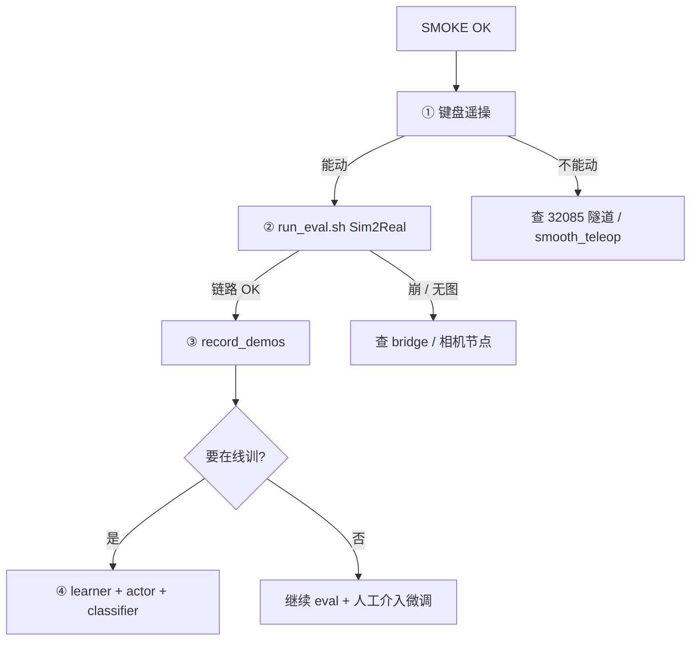

# 2026-06-22 · smoke 通过后下一步

## 当前状态（已验证）

```
images {'front': (1, 128, 128, 3), 'wrist': (1, 128, 128, 3)}
state shape (1, 25)
SMOKE OK
```

| 链路 | 状态 |
|------|------|
| Manjaro ZED + 鱼眼 → `image_tcp_server` | ✅ |
| Ubuntu `ImageTcpBridge` :32087 | ✅ |
| 夹爪 TCP :32086 | ✅ |
| 机械臂 SDK（reset 时连上） | ✅ |
| Wrapper 栈（键盘 HIL + SERL obs） | ✅ |

**置信度**：端到端 env 初始化可用 — **高**（smoke 实测通过）。

---

## 运行前常驻（每次真机会话）

| 机器 | 终端 | 命令 |
|------|------|------|
| Manjaro A | 相机 | `ros2 run myzed zed_camera_node`（鱼眼 `/image_raw` @ `/dev/video2`） |
| Ubuntu B | 臂隧道 | `ssh -N -L 32085:<臂控IP>:8899 Manjaro` |
| Ubuntu | DISPLAY | `export DISPLAY=:52.0`（OpenCV 窗口） |

夹爪 **32086**、图像 **32087** 由 env 自动起；smoke 结束后 bridge 可能释放端口，**下次 eval/actor 会再起**。

---

## 推荐顺序

### ① 键盘遥操闭环（~5 分钟，**先做**）

目的：确认臂 + 夹爪 + 双相机在 HIL 下可控，熟悉按键。

```bash
source ~/hil-serl/.venv/bin/activate
export DISPLAY=:52.0
cd ~/hil-serl/examples
python -c "
from experiments.mappings import get_train_config
import numpy as np
env = get_train_config('aubo_pick_cube_real').get_environment(fake_env=False)
obs, _ = env.reset()
print('Space=介入  WASD/RF=平移  JLKIUO=RPY  [/]=夹爪  Enter=成功  ESC=失败')
z = np.zeros(7, np.float32)
for _ in range(600):
    obs, r, term, trunc, info = env.step(z)
    if term or trunc:
        obs, _ = env.reset()
env.close()
"
```

**通过标准**：Space 后 WASD 能动臂；`[`/`]` 夹爪有响应；窗口有 front/wrist 画面。

### Space / 键盘在哪台机器按？

| | |
|--|--|
| **进程跑在哪** | **Ubuntu**（`wmtlab-ubuntun-server2`）— `smoke_env.sh` / `run_eval.sh` / `record_demos.py` 都在这台 |
| **按键监听** | `pynput` 挂在 Ubuntu 上 Python 进程的**本机输入**，不是 Manjaro |
| **Manjaro** | 只跑相机 ROS + `image_tcp_server` + 臂 SDK 隧道对端；**不要**在 Manjaro 按 Space |

**实际操作**：在能连到 `DISPLAY=:52.0` 的那块「桌面」上按：

- 若用 **VNC/远程桌面** 连 Ubuntu → 焦点在 OpenCV 窗口或该 VNC 会话里，用**你笔记本键盘**按 Space
- 若 Ubuntu 接**物理键盘** → 在 Ubuntu 上按
- **纯 SSH 终端、没有图形会话焦点** → pynput **收不到** Space/WASD（常见踩坑）

确认：按 Space 后终端或窗口应出现 intervention 相关提示；WASD 只在 **Space 打开 intervention 之后** 才控臂。

---

### ② Sim2Real 评测（验证策略 + 整条 actor 链路）

```bash
cd ~/hil-serl/examples/experiments/aubo_pick_cube_real
export DISPLAY=:52.0
export CHECKPOINT_PATH=~/hil-serl/checkpoints/aubo_pick_cube_sim_rsa
export EVAL_STEP=5000          # 按你 sim 实际 step 改
export EVAL_N_TRAJS=5
bash run_eval.sh
```

- **不要按 WASD**（除非 Space 主动介入）
- 成功率低属正常（Sim2Real gap）
- **通过标准**：策略能连续 step、不崩、夹爪有动作；你可 Space 随时接管

---

### ③ 录真机 demo（为 RSA / BC 准备）

```bash
cd ~/hil-serl/examples
python record_demos.py \
  --exp_name=aubo_pick_cube_real \
  --successes_needed=20
```

- **Enter** 标成功，**ESC** 标失败
- Space 介入遥操
- 输出：`demo_data/aubo_pick_cube_real_*_demos_*.pkl`

---

### ④ 在线 HIL 训练（可选，链路最长）

```bash
# 终端 1 — learner（有 GPU 的机器）
cd ~/hil-serl/examples/experiments/aubo_pick_cube_real
bash run_learner.sh

# 终端 2 — actor（真机 Ubuntu）
bash run_actor.sh
```

**已知缺口**（置信度：高）：

| 缺口 | 影响 | 建议 |
|------|------|------|
| `config.py` 未接 reward classifier | 环境 `reward≈0`，纯 RL 难学 | 训练前接 `MultiCameraBinaryRewardClassifierWrapper`，或依赖键盘 Enter |
| checkpoint 默认 `aubo_pick_cube_real_rsa` 可能不存在 | learner 需 demo / 预训 ckpt | 先用 sim ckpt 或 ③ 的 demo |

---

## 决策树



---

## 命令速查

```bash
bash smoke_env.sh           # 已通过 ✅
bash run_eval.sh            # ② Sim2Real
python record_demos.py ...  # ③
bash run_learner.sh         # ④
bash run_actor.sh           # ④
bash deploy_manjaro_image_server.sh   # 仅改 image_tcp_server 后
```

---

## 若你只想做一件事

**先做 ① 键盘遥操** — 成本最低，能立刻发现臂/夹爪/显示问题，再开 eval 更安全。
