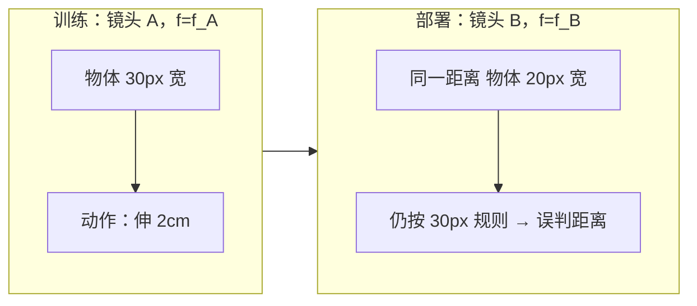

# 尺度过拟合（Scale Overfitting）与 RSA 为何有效

> 主要依据：CVPR 2026 — *Rethinking Camera Choice: An Empirical Study on Fisheye Camera Properties in Robotic Manipulation*（[项目页](https://robo-fisheye.github.io/)，[arXiv:2603.02139](https://arxiv.org/abs/2603.02139)）

---

## 一、尺度过拟合是什么？

### 1. 是什么

**一句话直觉**：Policy 把「物体在图像里占多少像素」当成了「物体离手有多远」的硬规则；换镜头、换焦距、换 sim/real 后像素大小变了，策略就判错距离。

**精确定义（视觉模仿学习 / 机器人操作语境）**：

在固定相机内参 $K$（焦距 $f$、主点等）下训练的视觉 policy $\pi(a \mid o)$，若其决策隐式依赖**绝对像素尺度** $s_{\text{px}}$（目标 bbox 宽度、与夹爪的像素比等），而非**与场景无关的相对几何关系**，则称发生了 **scale overfitting**。

**边界**：
- **解决/描述**：跨相机、跨焦距、sim→real 时因成像尺度变化导致的泛化失败。
- **不解决**：纯几何畸变（桶形畸变）本身——hil-serl pipeline 不做 undistort，但论文指出跨相机失败的主因往往是**尺度**而非畸变形状。

### 2. 怎么用（识别与后果）

**典型失败模式**（同一物理距离 $d$，不同镜头）：

| 现象 | 图像上物体 | Policy 误判 | 行为 |
|------|-----------|------------|------|
| 换更广角 / 更小 $f$ | 物体 **变小**（minification） | 以为 **更远** | 伸过头（overshoot） |
| 换更长焦 / 更大 $f$ | 物体 **变大**（magnification） | 以为 **更近** | 伸不够（undershoot） |

**易错点**：
1. 把失败归因于「鱼眼畸变形状」——论文实验表明，**换内参导致的绝对像素尺度变化**往往是跨相机 transfer 的主因。
2. 以为 $\pm 4$ 像素的 random crop 够用——它几乎不改变物体相对画面的比例，**打不破**对绝对尺度的记忆。

### 3. 谁提出的 / 来自哪里

- **系统命名与实证**：Han Xue 等，CVPR 2026，*Rethinking Camera Choice*（上海交大等）。
- **思想前身**：尺度/分辨率鲁棒性在 CV 里长期存在（多尺度训练、Scale jitter、RandomResizedCrop 等）；该文把它**明确诊断**为机器人模仿学习里 **cross-camera transfer** 的根因，并 tied 到 wrist 鱼眼场景。

### 4. 为什么叫这个名字

- **Scale**：成像尺度 / 物体在图像中的相对大小（像素域）。
- **Overfitting**：网络在训练分布上「过拟合」了某一固定 $K$ 下的 $s_{\text{px}} \leftrightarrow \text{depth}$ 伪相关，而非学到真正的 3D 关系。

---

## 二、第一性原理：Policy 在学什么？

视觉 policy 从像素到动作，没有显式深度图、没有标定矩阵进网络时，只能学**统计相关性**：

$$
\pi(a \mid I) \approx f\big(\phi(I)\big), \quad \phi: \text{图像} \to \text{特征}
$$

若训练数据里相机固定、场景简单，则存在**捷径（shortcut）**：

$$
\text{depth} \;\propto\; \frac{1}{\text{object pixel size}}
$$

网络可以记住：「方块宽 $w_{\text{px}}=30$ → 手再伸 2 cm」，而不学「方块边缘与夹爪指尖的 **相对比例**」。

### 针孔成像（尺度从哪来）

薄透镜近似下，物体在像平面上的高度：

$$
h_{\text{img}} = \frac{f \cdot H_{\text{world}}}{Z}
$$

- $f$：焦距（内参）
- $H_{\text{world}}$：物体真实高度
- $Z$：物距

**换镜头 = 换 $f$** → 同一 $(H_{\text{world}}, Z)$ 下 $h_{\text{img}}$ 变 → policy 若绑定了旧的 $h_{\text{img}}$，动作就错。

### 和鱼眼的关系

鱼眼 FoV 大（如 130°–180°），同一距离下边缘/中心像素密度不均；但 hil-serl 端到端 ResNet **不建模 $K$**。论文结论：**跨硬件失败时，scale overfitting 是主因**；鱼眼 + 固定训练镜头时，policy 同样会死记该镜头下的像素尺度。

---

## 三、RSA 是什么？为什么能对抗尺度过拟合？

### 1. 是什么

**RSA（Random Scale Augmentation）**：训练时对每张图随机采样缩放因子 $s \sim \mathcal{U}(s_{\min}, s_{\max})$（论文常用 $0.7$–$1.3$），缩放后再 pad/crop 回原分辨率 $H \times W$。

**精确定义**：在输入空间构造一族 $\{T_s(I)\}_{s \sim p(s)}$，使同一语义场景在像素域呈现**多种绝对尺度**，迫使 $\phi$ 对 $s$ 不敏感或只依赖**相对比例**（目标 vs 夹爪、目标 vs 桌面纹理等）。

### 2. 怎么用

对 $128 \times 128$ 图像：

1. 采样 $s \sim \mathcal{U}(0.7, 1.3)$
2. 双线性 resize 到 $(\lfloor 128s \rfloor, \lfloor 128s \rfloor)$
3. **居中 pad**（常用 edge 或 black border）回 $128 \times 128$

- $s > 1$：先缩小再 pad → 类似 **zoom-out**（物体在画面里更小）
- $s < 1$：先放大再 crop → 类似 **zoom-in**（物体更大）

与 `batched_random_crop(padding=4)` 对比：

| 增强 | 典型尺度变化 | 能否打破 $h_{\text{img}}$ 记忆 |
|------|-------------|-------------------------------|
| random crop ±4px | $\approx 1 \pm 0.03$ | 几乎不能 |
| RSA $s \in [0.7, 1.3]$ | $0.7$–$1.3$ 倍 | **能**（刻意模拟换焦距效果） |

### 3. 谁提出的 / 来自哪里

- **在机器人鱼眼语境下作为 cross-camera  remedy**：同上 CVPR 2026 论文正式提出并 ablation。
- **方法本身**：与 ImageNet 的 RandomResizedCrop、多尺度训练同源思想；该文价值在于**问题诊断 + 在 manipulation IL 上验证**。

### 4. 为什么叫这个名字

- **Random**：每个 batch / 每张图独立采样 $s$。
- **Scale**：直接改变像素域全局缩放。
- **Augmentation**：训练期数据增强，推理时不做。

---

## 四、RSA 为何有效？（因果链）

### 机制 1：破坏捷径，逼学相对关系

无 RSA 时，损失可下降的一条路是：

$$
\hat{a} = g(w_{\text{px}}^{\text{cube}}, h_{\text{px}}^{\text{gripper}})
$$

有 RSA 时，同一物理状态对应多种 $(w_{\text{px}}, h_{\text{px}})$，**绝对像素数不再是稳定标签**，网络更可能学：

$$
\hat{a} = g\left(\frac{w_{\text{px}}^{\text{cube}}}{w_{\text{px}}^{\text{gripper}}},\ \text{接触几何},\ \text{纹理上下文}\right)
$$

论文表述：learn **relative spatial relationships**（目标相对夹爪的尺度），而非 absolute pixel size。

### 机制 2：在训练集内模拟「换镜头」

换焦距 $f \to f'$ 时，全局缩放近似：

$$
\frac{h_{\text{img}}'}{h_{\text{img}}} \approx \frac{f'}{f}
$$

RSA 在固定 $f$ 的数据上，用 $s$ 在像素域模拟一族 $\{f'/f\}$，**扩宽训练时的尺度分布**，减轻对单一 $K$ 的过拟合。

### 机制 3：与 IL 损失兼容

RSA 只改观测 $I$，不改动作标签 $a$（同一 demo 里动作仍是正确的 EE delta）。增强的是 **observation invariance**，不要求重新标定或改架构——论文强调 **plug-and-play**。

---

## 五、优势与劣势（风险）

| | 说明 |
|---|------|
| **优势** | 实现简单；不改网络；对 cross-camera / 换 wrist 镜头有论文实证；与真机鱼眼数据 + 多样化场景可叠加 |
| **劣势** | $s$ 范围过大可能引入不物理的空白边（black padding）分布；**不能替代** train/deploy 相机一致性的基本需求；sim 针孔 + RSA 部署真机鱼眼仍有 domain gap（置信度：中） |
| **hil-serl 现状** | 尚未实现 RSA；仅 `padding=4` crop，对尺度过拟合**几乎无效** |

---

## 六、记忆锚点

> **尺度过拟合**：把「30 像素宽 = 该伸 2 cm」写进权重；换镜头变成 20 像素就懵。  
> **RSA**：训练时故意把物体缩成 21–39 像素宽，逼网络看「和夹爪比谁大」，而不是死记 30。

---

## 七、Sources

- [Rethinking Camera Choice — Project Page](https://robo-fisheye.github.io/)
- [CVPR 2026 Open Access](https://openaccess.thecvf.com/content/CVPR2026/html/Xue_Rethinking_Camera_Choice_An_Empirical_Study_on_Fisheye_Camera_Properties_CVPR_2026_paper.html)
- [arXiv:2603.02139](https://arxiv.org/abs/2603.02139)
