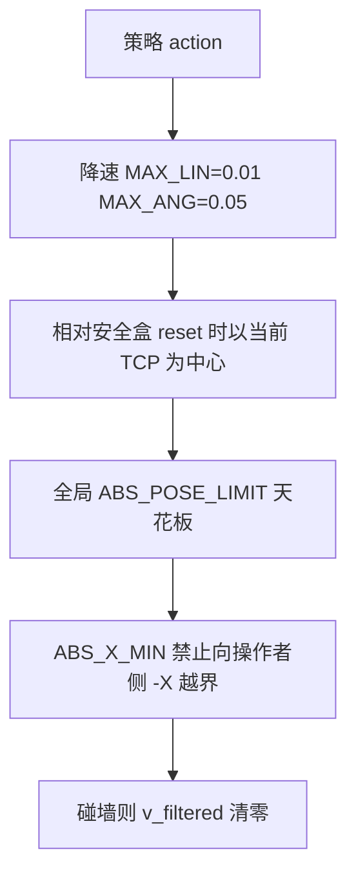

# 2026-06-22 · 真机 RL 安全探索范围

## 刚才 eval 为什么会抽搐？

| 因素 | 说明 |
|------|------|
| Sim2Real 域差 | 仿真 checkpoint 在真机上的动作分布不可信，易高频换向 |
| **无工作空间硬限** | `ABS_POSE_LIMIT` 此前为 `±inf`，代码里**未裁剪** |
| 速度上限 | 策略 `action∈[-1,1]` 映射到 `MAX_LIN_VEL=0.02` m/s，换向仍显「抖」 |
| 无 HIL 介入 | eval 模式不走键盘 `Space` 人工接管 |

**结论**：不 eval、从头真机 RL 是合理选择；必须先加**硬边界 + 降速 + 随时 Space 介入**。

---

## 已实现的防护（三层）



### 1. 降速 + 关节软限

`config.py` → `EnvConfig`：

- `MAX_LIN_VEL = 0.01`（原遥操 0.02 的一半）
- `MAX_ANG_VEL = 0.05`（原 0.1 的一半）
- `TELEOP_JOINT_LIMITS = False` → 使用 SDK **SAFE** 关节速度（0.1 rad/s 级）

### 2. 相对安全盒（推荐）

每次 `env.reset()`：

1. 读取当前 TCP（你应先把臂摆在**方块上方安全悬停**）
2. 以该点为心，± `WORKSPACE_MARGIN_*` 建盒
3. `-X` 方向 margin **更大**（`0.10` vs `0.05`），减少朝你坐的方向探出去
4. 越界 → 位置裁剪 + **速度清零**（不会顶着手硬冲）

reset 时终端会打印：

```
[safety] workspace xyz low=[...] high=[...]
```

### 3. 全局绝对上限

`ABS_POSE_LIMIT_LOW/HIGH`：整桌任务区域的硬天花板（与仿真桌面布局对齐的初值，**需标定**）。

`ABS_X_MIN = 0.02`：无论 reset 在哪，TCP 的 **x 不得低于此值**（挡操作者一侧）。

---

## 真机 RL 推荐流程（跳过 eval）

### ① 标定安全盒（5 分钟）

臂移到方块上方悬停，人坐在平时操作位置：

```bash
source ~/hil-serl/.venv/bin/activate
export AUBO_SDK_DIR=~/hil-serl/python3.x
export LD_PRELOAD=~/hil-serl/python3.x/protobuf_deepbind.so  # 若连 SDK 崩 protobuf
cd ~/hil-serl/examples/experiments/aubo_pick_cube_real
python print_tcp_pose.py
```

根据输出的 `xyz low/high` 检查是否盖住桌面、是否离你够远。必要时改 `config.py` 里：

- `WORKSPACE_MARGIN_LOW/HIGH`
- `ABS_X_MIN`
- `ABS_POSE_LIMIT_*`

### ② 录 demo（HIL）

```bash
# 参考 record_demos / 键盘遥操；Space=介入，Enter/ESC 结束 episode
```

### ③ 开 learner + actor（非 eval）

```bash
# 终端 1
bash run_learner.sh

# 终端 2 — 不要带 eval_checkpoint_step
export CHECKPOINT_PATH=~/hil-serl/checkpoints/aubo_pick_cube_real_rsa
bash run_actor.sh
```

训练时：**Space 随时接管**；策略动作只在安全盒内积分。

### ④ 逐步放开（可选）

学会稳定后，再小幅提高 `MAX_LIN_VEL` / margin；**不要**在未标定前去掉安全盒。

---

## 参数速查

| 参数 | 默认 | 作用 |
|------|------|------|
| `ENABLE_RELATIVE_SAFETY_BOX` | `True` | reset 时以当前 TCP 建盒 |
| `WORKSPACE_MARGIN_LOW` | `[0.10,0.12,0.08,...]` | 向 -X/-Y/-Z 等方向余量 |
| `WORKSPACE_MARGIN_HIGH` | `[0.05,0.12,0.12,...]` | +X/+Y/+Z 余量 |
| `ABS_X_MIN` | `0.02` | 全局 x 下限（挡人） |
| `ABS_POSE_LIMIT_*` | 见 config | 全局硬天花板 |
| `MAX_LIN_VEL` | `0.01` | RL 线速度上限 |
| `MAX_ANG_VEL` | `0.05` | RL 角速度上限 |

---

## 风险说明

| 措施 | 优势 | 仍存风险 |
|------|------|----------|
| 相对安全盒 | 跟任务起点走，易标定 | reset 时臂若摆太高/太偏，盒也跟着偏 |
| 降速 | 抽搐幅度小 | 未介入时仍可能碰物 |
| ABS_X_MIN | 挡向人一侧 | 需按你真实座位调 `ABS_X_MIN` |
| Space 介入 | 最终保险 | 依赖你能按到键 |

**置信度**：硬裁剪逻辑 — **高**（与 Franka `clip_safety_box` 同思路）；默认 margin 数值 — **中**（需你 `print_tcp_pose.py` 现场确认）。

---

## 修改的文件

- `serl_robot_infra/franka_env/envs/aubo_i10_real_env.py` — 安全盒裁剪
- `examples/experiments/aubo_pick_cube_real/config.py` — 真机 RL 默认参数
- `examples/experiments/aubo_pick_cube_real/print_tcp_pose.py` — 标定工具
