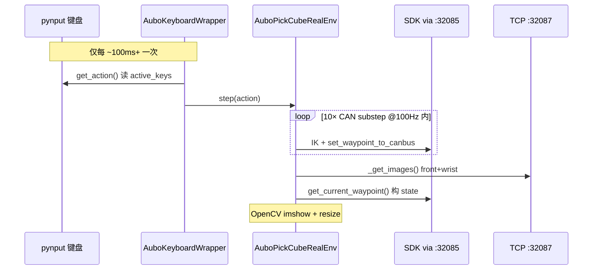

# 2026-06-22 · 真机键盘遥操卡顿原因

## 结论（先说）

**主要不是臂隧道 SSH 环回的问题。**

你和 `smooth_teleop.py` 用的是**同一条臂隧道** `127.0.0.1:32085`。若 smooth_teleop 顺滑、hil-serl 卡顿，瓶颈在 **hil-serl 控制/观测循环设计**，不在 32085 本身。

| 因素 | smooth_teleop | hil-serl `get_environment()` |
|------|---------------|-------------------------------|
| 控制环频率 | **100 Hz** | 策略 **10 Hz**（每步才读一次键盘 action） |
| 每步额外工作 | 几乎只有 CAN+IK | 双路 TCP 取图 + SDK 查状态 + OpenCV 显示 + 多层 wrapper |
| 臂 SSH 隧道 | 32085 | 32085（相同） |
| 图像 SSH | 无 | 32087（每步要等观测，加重步时长） |

**置信度**：高（代码路径对比 + 你侧 smooth_teleop 已验证同隧道可用）。

---

## 第一性原理：一步 `env.step()` 里发生了什么



### 1. 策略 10 Hz（主因）

`aubo_control_config.py`：

```python
POLICY_HZ = 10.0          # 每步 100ms
CAN_LOOP_HZ = 100.0       # 步内 10 个子步，共 ~100ms
```

- **键盘**只在每个 `env.step()` 调一次 `get_action()`，不是 100 Hz 跟手。
- 子步里速度指令**固定不变**整 100ms → 体感像「一格一格走」，不是 SSH 随机丢包那种抖。

`smooth_teleop` 是 **100 Hz** 每圈更新 `v_filtered` 并下发 CAN。

### 2. 每步观测开销（加重卡顿）

每步 `step()` 末尾还会：

| 操作 | 代价 |
|------|------|
| `_get_images()` | 两路 `VideoCapture.read()`；底层两线程抢**同一条** image TCP 锁，各走一趟 Manjaro JPEG 往返 |
| `build_aubo_state_from_sdk()` | 再调一次 `robot.get_current_waypoint()`（又一次 **32085 SDK 往返**） |
| `GymHilCameraDisplayWrapper` | resize×3 + `imshow` |

若这些合计再占 50–200ms，有效环可能掉到 **~3–5 Hz**，比 10 Hz 还卡。

### 3. SSH 各隧道分工

| 端口 | 用途 | 对臂流畅度 |
|------|------|------------|
| **32085** | Aubo SDK（动臂） | smooth_teleop 已证明够用；hil-serl 每步多一次 `get_current_waypoint` |
| **32086** | 夹爪 | 仅 `[`/`]` 时触发，不是连续卡顿主因 |
| **32087** | JPEG 双相机 | **不直接控臂**，但拖慢 `step()` 周期 → 间接让键盘采样更稀疏 |

图像隧道是 **观测瓶颈**，不是臂环回本身坏了。

### 4. 双重速度滤波（次要，偏「钝」）

干预时：`get_action()` 里 `normalized_from_keys` 做一次 EMA → env 里 `update_from_action` 再做一次 EMA。响应会比 smooth_teleop **更钝**，但单独不足以解释「一顿一顿」；主因仍是 **10 Hz 离散采样**。

---

## 怎么自证（2 分钟）

### A. 对比 smooth_teleop（你已在做）

```bash
cd ~/hil-serl/python3.x
python3 smooth_teleop.py --no-ros \
  --robot-ip=127.0.0.1 --robot-port=32085 \
  --gripper-via-ssh=Manjaro
```

- **顺滑** → 32085 隧道 OK，问题在 hil-serl 环。
- **也卡** → 再查 32085 隧道 / 臂控 / 网络。

### B. 测 hil-serl 实际步频

```bash
source ~/hil-serl/.venv/bin/activate
export DISPLAY=:52.0
cd ~/hil-serl/examples
python -c "
import time, numpy as np
from experiments.mappings import get_train_config
env = get_train_config('aubo_pick_cube_real').get_environment(fake_env=False)
env.reset()
# 先 Space 打开 intervention
z = np.zeros(7, np.float32)
t0 = time.time()
n = 50
for _ in range(n):
    env.step(z)
print(f'50 steps in {time.time()-t0:.2f}s => {n/(time.time()-t0):.1f} Hz')
env.close()
"
```

若显示 **~3–10 Hz**（远低于 smooth 的 100 Hz），与上述分析一致。

---

## 建议怎么用

| 目的 | 做法 |
|------|------|
| **验臂/夹爪手感** | 用 **smooth_teleop**（专为此设计） |
| **验 hil-serl 全链路** | 接受 10 Hz 键盘会卡；看 **策略 eval** 时同样 10 Hz，与训练一致 |
| **临时减轻卡顿** | `display_scale=1`；遥操脚本少跑 wrapper（仅当改 config 测试） |

训练策略本来就是 **10 Hz**；真机 env 卡顿与 **RL 实际执行频率一致**，不算是隧道配错了，而是 **HIL 训练环 ≠ 纯遥操环**。

---

## 若以后要改代码（可选，未做）

1. 遥操专用模式：干预时 **100 Hz 内环**读键盘，观测/decimation 仍 10 Hz  
2. 遥操时跳过或降频 `get_current_waypoint` / 显示  
3. 图像与控制在不同线程（控制不被 `_get_images` 堵住）

**优势**：遥操跟手；**风险**：与训练 10 Hz 行为不一致，需单独测 eval。

---

## 记忆锚点

- **smooth_teleop = 赛车方向盘（100Hz）**  
- **hil-serl env.step = 每 100ms 拍一张照、查一次状态、再动一小段（10Hz）**  
- 同一条路（32085），只是发车频率不同。
