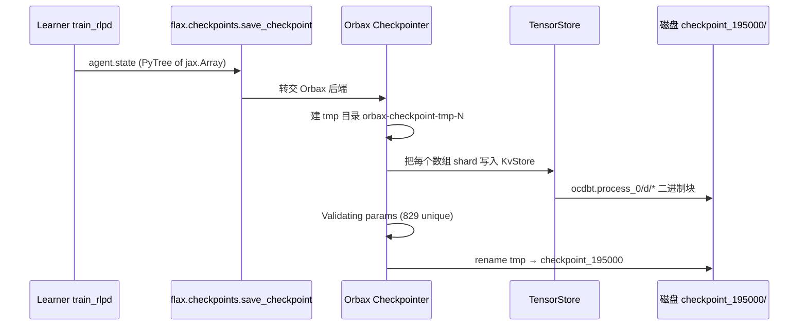

# 2026-06-23 · Orbax checkpoint 里 KvStore 是啥？整条存盘链路做了什么？

## 从你这行代码出发

`train_rlpd.py` learner 每 5000 步：

```python
checkpoints.save_checkpoint(
    os.path.abspath(FLAGS.checkpoint_path),
    agent.state,      # ← 只存 JaxRLTrainState，不是整个 agent
    step=step,
    keep=100,
)
```

**存的是什么**：`SACAgent.state`（`JaxRLTrainState`），即 SAC 网络的权重 + 优化器状态 + 训练步数等。

**不存什么**：`apply_fn`、`txs`（优化器定义）、`agent.config` — 它们在 Flax struct 里标了 `pytree_node=False`，不在 checkpoint 里；恢复时用代码重新构造 agent 再 `restore_checkpoint`。

对你仓库 `checkpoint_195000` 实测 `_METADATA` 里 **833 个叶子**：

| 前缀 | 数量 | 含义 |
|------|------|------|
| `opt_states` | 668 | Adam 等优化器的动量/二阶矩（每个可训练参数多份状态） |
| `params` | 81 | 当前策略：actor / critic / grasp_critic / temperature 权重 |
| `target_params` | 81 | SAC 目标网络（软更新那份） |
| `step` | 1 | 训练步数 195000 |
| `rng` | 1 | JAX 随机数状态 |
| `epsilon` | 1 | 标量（若启用） |

总数据量日志里约 **305 MiB**（压缩后落盘）。

---

## 整条链路（你看到的日志对应哪一步）



### 日志逐步对照

| 日志 | 在干什么 |
|------|----------|
| `Using Orbax as backend` | Flax 不再用老式「每参数一个 pickle」，改用 Orbax |
| `Started saving checkpoint` | 开始 step=195000 这一次保存 |
| `Creating tmp directory ...tmp-3` | **原子写**：先写临时目录，成功后再 rename，避免写一半损坏 |
| `blocking_bytes_per_sec: 2.8 GiB/s` | 把 GPU/内存里的数组 **同步拷到写缓冲** 的速度 |
| `bytes_per_sec: 643 MiB/s` | **真正落盘**（含压缩、建索引）的速度 |
| `Validating params in TensorStore KvStore` | 写完后 **读回校验**：键是否齐全、能否打开 |
| `raw input=1658, unique=829` | 校验时见到的 tensor 条目数（含分片/元数据重复计数）vs 去重后的参数个数 |
| `Renaming tmp → checkpoint_195000` | 提交成功，对外可见 |

---

## KvStore 是什么？

### 1. 是什么

**KvStore** 是 Google **TensorStore** 库里的抽象：**按键（key）读写一块二进制 value** 的存储接口，底层可以是本地文件、GCS、内存等。

直觉：不像 `numpy.save` 一个 `.npy` 一个文件那么简单，而是 **「名字 → 字节块」的数据库**，专门给 **超大、很多、可能分片的数组** 用。

- **边界**：管的是 **数组字节的存取与索引**，不管你的 RL 语义（那是 Orbax 在上层用 PyTree 路径当 key）。

### 2. 怎么用（在你这次 checkpoint 里）

日志里打印的 spec 大意是：

```text
driver: ocdbt
base:   file → .../checkpoint_195000.orbax-checkpoint-tmp-3/
```

含义：

1. **base**：文件系统上的目录（`file` driver）
2. **ocdbt**：在该目录上再套一层 **OCDBT** 索引（见下）
3. 每个网络参数（如 `params.modules_actor.Dense_0.kernel`）对应 KvStore 里的 **一个或多个 key**
4. value 里是 **zstd 压缩** 后的数组 chunk（你日志里 `'compression': {'id': 'zstd'}`）

恢复时 Orbax 反着走：读 `_METADATA` 知道 PyTree 结构 → 对每个叶子用 TensorStore 按 key 读出 → 拼成 `jax.Array` → 填回 `JaxRLTrainState`。

### 3. 谁发明的 / 来自哪里

- **TensorStore**：Google 开源（[tensorstore](https://github.com/google/tensorstore)），面向科学计算与 ML 的大规模数组 I/O。
- **OCDBT**：TensorStore 的 **Optionally-Cooperative Distributed B-tree** driver；Orbax 论文/文档将其作为默认高性能格式（[Orbax optimized checkpointing](https://orbax.readthedocs.io/en/stable/guides/checkpoint/optimized_checkpointing.html)）。
- **Orbax**：Google JAX 生态的 checkpoint 库，Flax `save_checkpoint` 现代后端。

### 4. 为什么叫 KvStore

- **Kv** = **Key-Value**（键值存储）
- **Store** = 存储层  
合起来就是 TensorStore 对「逻辑键 → 数组分片」的统一接口名；日志里写 `TensorStore KvStore` 表示 **正在用 TensorStore 的键值后端做校验**。

---

## OCDBT 又是什么？和 `manifest.ocdbt`、`d/` 的关系

**OCDBT**（Optionally-Cooperative Distributed B-tree）：把 **很多小数组** 合并进 **少量大文件**，用 B 树索引按 key 查找 chunk。

你磁盘上的结构（`checkpoint_195000/`）：

```text
checkpoint_195000/
├── _CHECKPOINT_METADATA    # 存盘起止时间戳（纳秒）
├── _METADATA               # PyTree 树结构：每个叶子对应哪个 key、dtype、shape
├── _sharding               # JAX 分片信息（多卡时用；你单机也有占位）
├── manifest.ocdbt          # 顶层 OCDBT 索引
├── d/                      # 合并后的大块数据文件（哈希文件名）
└── ocdbt.process_0/        # 单进程写入时的 per-process 子库
    ├── manifest.ocdbt
    └── d/                  # 实际 305MiB 主体多半在这里
```

**为什么有 `ocdbt.process_0`**：单机单进程时只有一个；多机训练时每个 host 先写自己的 `ocdbt.process_N`，最后再协调合并。你日志里是单 learner 进程，所以只有 `process_0`。

**旧格式 vs OCDBT**：旧 Orbax 往往 **每个参数一个子目录**，小文件极多、慢；OCDBT 默认开启，读写更快（Orbax 文档称 empirically 明显加速）。

---

## `Validating params` 那行在验什么？

```text
Validating params (raw input=1658, unique=829) in TensorStore KvStore
```

- 打开刚写好的 OCDBT KvStore
- 列出/核对所有 key 是否与 `_METADATA` 里声明的叶子一致
- **unique=829** ≈ 去重后的数组个数（与上面 833 叶子同量级；差几个可能是非数组字段或计数口径）
- **raw=1658** 往往包含分片、重复引用、元数据项 — **不是**「有 1658 个独立权重」

校验通过才会 `Renaming`；失败则不会改名，旧 checkpoint 不受影响。

---

## 和 replay buffer 的区别

同目录 `checkpoints/aubo_pick_cube_sim_rsa/` 下还有：

| 路径 | 格式 | 内容 |
|------|------|------|
| `checkpoint_195000/` | Orbax + TensorStore | **神经网络**（本次讲的） |
| `buffer/*.pkl` | Python pickle | 在线 replay 转移 |
| `demo_buffer/*.pkl` | pickle | 人类干预/demo 数据 |

**KvStore 只出现在 checkpoint 权重里**，buffer 不走这套。

---

## 恢复时发生了什么（eval / 断点续训）

```python
ckpt = checkpoints.restore_checkpoint(ckpt_dir, agent.state, step=...)
agent = agent.replace(state=ckpt)
```

1. 读 `_METADATA` 重建 PyTree 骨架  
2. 对每个 `params.*` / `opt_states.*` 用 TensorStore 从 KvStore 读字节 → `jax.Array`  
3. 填回 `JaxRLTrainState`  
4. `apply_fn`、`txs` 仍来自 Python 代码里新建的 agent  

所以 **checkpoint 不是整个程序快照**，而是 **可训练状态的数组集合**。

---

## 优劣势（帮你判断要不要关心它）

| | 优势 | 劣势 |
|--|------|------|
| KvStore + OCDBT | 大模型单文件少、压缩、校验、可扩展多机 | 目录 **人类不可读**，不能 `cat` 看权重 |
| 临时目录 + rename | 断电不会半套 checkpoint | 存盘瞬间占双倍磁盘（tmp + 正式） |
| 只存 `agent.state` | 文件相对小、恢复明确 | 换代码结构后旧 ckpt 可能 key 对不上 |

---

## 记忆锚点

把 checkpoint 想成：

> **一本带目录的词典（_METADATA）** + **一个按词条编号的压缩数据仓库（KvStore/OCDBT/d/）**  
> 词条名 = `params.modules_actor.Dense_0.kernel` 这种路径；内容是 float32 权重字节。

你看到的整段 INFO 日志，就是 learner 在 **第 195000 步** 往这本词典里 **覆写一版新的网络快照**。
