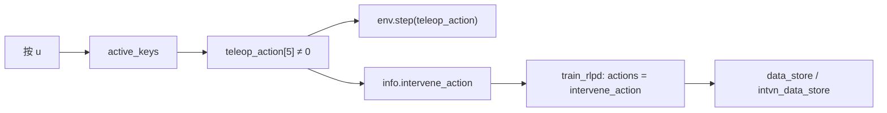

# 2026-06-23 · 按 `u`（Yaw）时 learner 能学到吗？

## 结论（先说）

| 场景 | `u` 的动作会进 buffer 吗？ | 动作上有没有被强行 fix？ |
|------|---------------------------|-------------------------|
| **Space 干预中**（你按着 `u`） | **会** — 完整 7D `intervene_action` 写入 replay | **不会** zero 掉 RPY |
| **策略自己跑**（没按 Space） | 策略可输出 **yaw（action[5]）**；roll/pitch 仍 zero | **部分** — `action[3:5]=0`，`action[5]` 放开 |

**置信度：高**（直接对应当前代码路径）。

---

## `u` 对应什么？

`TELEOP_KEY_MAP` 里：

```python
"o": (5,  1),   # Yaw +
"u": (5, -1),   # Yaw −
```

7D 动作向量：`[vx, vy, vz, roll, pitch, yaw, gripper]` → `u` 影响 **index 5（yaw）**。

---

## 干预时：learner 学到的是完整遥操动作

数据流：



关键代码：

**1. 策略模式：只锁 roll/pitch，yaw 放开**（2026-06-23 更新）：

```249:254:serl_robot_infra/franka_env/envs/aubo_hil_wrappers.py
        else:
            unwrapped._teleop_keys_fn = None
            # Lock roll/pitch only; policy may output yaw (action[5], keyboard u/o).
            action = np.asarray(action, dtype=np.float32).copy()
            action[3:5] = 0.0
```

**2. 干预时不 zero 任何角速度维**（只有非干预才改 action）：

```347:350:serl_robot_infra/franka_env/envs/aubo_hil_wrappers.py
        if info.get("is_intervention", False) and "teleop_action" in info:
            info["intervene_action"] = np.asarray(
                info["teleop_action"], dtype=np.float32
```

**4. Actor 用干预动作覆盖 policy 动作再入库**：

```186:188:examples/train_rlpd.py
            if "intervene_action" in info:
                actions = info.pop("intervene_action")
```

干预步：label 为完整遥操；非干预步：label 为 policy 输出（含 yaw 维）。

---

## 仿真里 `u` 真的会转吗？

会。速度积分把 `action[3:6]` 并进角速度，MuJoCo 控制器用 `rpy2r(action[3:6])` 更新姿态：

```44:45:serl_robot_infra/franka_env/envs/aubo_velocity_control.py
        v_target[:3] = action[:3] * self.max_lin_vel
        v_target[3:] = action[3:6] * self.max_ang_vel
```

```113:114:serl_robot_infra/franka_env/envs/aubo_mujoco_controller.py
        self.p0 += action[:3]
        self.R0 = self.R0.dot(rpy2r(action[3:6]))
```

---

## 但有两个「学不好 yaw」的结构性限制

### 1. 策略探索时只锁 roll/pitch

非干预步里 policy 的 roll/pitch 仍会被清掉，**yaw（action[5]）已放开**：

$$a_{\text{env}}^{3:5} = 0,\quad a_{\text{env}}^{5}\ \text{来自 policy}$$

roll/pitch 仍锁死以防末端翻滚；yaw 可由策略自己探索并与干预示范对齐。

### 2. Sim 的 proprio 里 `tcp_pose` 的 RPY 恒为 0

`build_aubo_state` 故意对齐 Panda，姿态维不写进 obs：

```162:167:serl_robot_infra/franka_env/envs/aubo_hil_wrappers.py
    # RPY hardcoded to zero — aligned with gym_hil PandaPickCubeGymEnv
    return {
        "tcp_pose": np.concatenate(
            [p.astype(np.float32), np.zeros(3, dtype=np.float32)]
        ),
```

Learner 仍可通过 **`q`（关节角）** 和 **图像** 间接感知转动，但 **没有显式 yaw 状态**。  
要学稳 yaw，难度比有完整 `tcp_pose` 的真机大。

真机 `get_cached_proprio_state()` 里 **RPY 是真实的**，这点比 sim 友好。

---

## 实操检查清单

1. 干预时必须 **按住 Space**，否则 `u` 只改键盘状态、不进 `intervene_action`。
2. 看 actor 日志里 `intervention_steps` 是否在涨 — 涨说明干预步在入库。
3. 策略步已允许 **yaw 输出**；roll/pitch 仍被 wrapper 清零。
4. 若希望 sim 也显式学姿态，需要改 `build_aubo_state` 写入真实 RPY（当前故意为零）。

---

## 优劣势

| | 优势 | 劣势（风险） |
|--|------|-------------|
| 干预时保留完整 7D | 人类示范的 yaw 原样进 RLPD / 干预 buffer | — |
| policy 时只锁 roll/pitch | 防翻滚，仍允许 yaw 探索 | yaw 无显式 proprio（sim）时难学稳 |
| sim tcp_pose RPY=0 | 与 Panda pipeline 一致 | yaw 主要靠 `q`+图像 |
