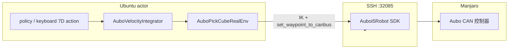
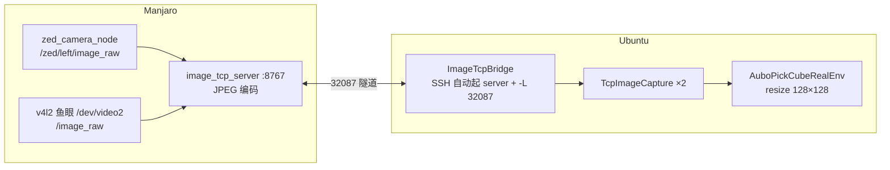

# 对话记录：一周工作日志 + Route B 薄控制器

> 日期：2026-06-23  
> 本文件为本对话全部产出，**仅此一份**。

---

## 对话 1：总结最近一周 worklog

### 总览（2026-06-17 ~ 06-23）

| 主线 | 进展 | 状态 |
|------|------|------|
| 仿真 HIL-RL | 键盘遥操、录 demo、Route B 重构、RSA | 可训；pickup 已 MuJoCo 化 |
| Aubo 真机 | smooth_teleop 对齐、夹爪 TCP、ZED 鱼眼、smoke | 端到端 env 可用 |
| 算法/理论 | SAC/HIL、泛化机制、系统辨识、安全盒 | Sim2Real 可跑 |

**里程碑**：sim/real 控制语义统一；smoke 通过；Route B；RSA；三层安全盒。

### 按日（极简）

- **6/17** 仿真 HIL 流程、`train_rlpd` 修复
- **6/19** demo 后训练路径；仿真不需 classifier
- **6/20** 训练臂太快原因；JAX 预取
- **6/21** 真机对齐、夹爪 SSH/TCP、系统辨识 Δq RMSE 0.0033、SAC 理论
- **6/22** Route B 重构、相机 TCP、smoke 通过、遥操 100Hz、RSA、eval protobuf 修复
- **6/23** 安全盒默认值

### 未完成

P0 键盘遥操验证、Sim2Real eval；P1 真机 demo、classifier；P2 真机 HIL actor/learner。

---

## 对话 2：Route B 薄控制器 — 在哪？做了吗？

### 结论

**做了，当前仍在用。** pickup 仿真不再走 `HeadlessMyEnv → MyEnv`，改为 `AuboMujocoController`。未完全脱离 MyI10Tele（仍用 `MuJoCoParser`、`solve_ik`）。

### 看哪里

| 优先级 | 文件 |
|--------|------|
| 1 | `serl_robot_infra/franka_env/envs/aubo_mujoco_controller.py` |
| 2 | `serl_robot_infra/franka_env/envs/aubo_i10_gym_env.py`（`self._ctrl = AuboMujocoController(...)`） |
| 3 | `.specstory/history/2026-06-22_RouteB原生MuJoCo重构.md` |
| 4 | `$MYI10TELE_ROOT/assets/aubo_i10_inspire/pickup_scene.xml` |

### 架构

```
旧：GymEnv → HeadlessMyEnv → MyEnv → MuJoCoParser (+ 运行时 patch)
新：GymEnv → AuboMujocoController → MuJoCoParser (+ pickup_scene.xml 写死)
```

`myenv` 属性还在，类型变成 `AuboMujocoController`。

### 验证命令

```bash
rg 'HeadlessMyEnv' serl_robot_infra examples --glob '*.py'   # 应无匹配
rg 'AuboMujocoController' serl_robot_infra --glob '*.py'     # controller + gym_env
```

---

## 对话 3：原理、功能、怎么做？

### 一句话

末端增量 → IK → 重力补偿关节伺服 → `mj_step`，从 MyEnv 抽出 ~170 行 `AuboMujocoController` + 专用 `pickup_scene.xml`。

### 原理

**时间尺度**：Policy 10Hz → 10×CAN 子步 100Hz → 每子步多次 `mj_step`（dt=0.002s）。

**速度积分**（与真机共用 `AuboVelocityIntegrator`）：

$$
v_{\text{filt}} \leftarrow \alpha v_{\text{target}} + (1-\alpha) v_{\text{filt}},\quad
\Delta p = v_{\text{filt},0:2} \Delta t
$$

**增量 IK**：$p_0 \mathrel{+}= \Delta p$，$R_0 \mathrel{=} R_0 \cdot \text{rpy2r}(\Delta\text{rpy})$ → `solve_ik` → $q^*$。

**重力补偿**（position actuator）：

$$
\text{ctrl} = q_{\text{target}} + g(q)/k_p \quad\Rightarrow\quad \tau = k_p(q_{\text{target}}-q) + g
$$

`g` 由 `mj_rne(qacc=0)` 算。

### 实现了什么

**Controller**：`step(Δee)` + `step_env(nstep)` + `sync_flange_frame_from_sim()`。不做 place 逻辑、GLFW、运行时 patch。

**GymEnv**：obs/reward/success 对齐 Panda；action 7D 速度；reset 直接 qpos+cube；action≈0 时 hold。

### 怎么重构的

1. 新建 `pickup_scene.xml`（cube freejoint、相机写死）
2. `AuboMujocoController` 替代 `HeadlessMyEnv`
3. `AuboPickCubeGymEnv` 自管 cube/mocap/渲染/reward
4. `.myenv` 别名兼容 wrapper/sysid

### 关键代码

- 初始化：`aubo_i10_gym_env.py` L76 `self._ctrl = AuboMujocoController(...)`
- 有动作：`_integrate_velocity_action` → 10 子步 `_ctrl.step` + `_ctrl.step_env`
- 无动作：`_advance_physics_hold` 保持当前 q
- IK+补偿：`aubo_mujoco_controller.py` `step()` / `step_env()`

### sim vs real

共享 `AuboVelocityIntegrator` + `aubo_control_config`；sim 走 MuJoCo IK，real 走 Aubo SDK CAN。

---

## 对话 4：为啥不用项目已有的 Franka 控制器？

### 直接回答

**不完全是「没有现成控制器」。** 更准确的说法：

1. **hil-serl 里 Franka 那套不能直接套 Aubo**（机器、MJCF、控制律都不同）
2. **Aubo 其实一开始就在用「已有」控制器：`MyEnv`（MyI10Tele）** —— Route A
3. **Route B 不是因为 MyEnv 跑不起来，而是它带 place 任务包袱，且控制语义要对齐真机 CAN 速度**

### 「项目已有的控制器」其实有三套，别混

| 名字 | 干什么 | 能用于 Aubo 仿真吗 |
|------|--------|-------------------|
| **`gym_hil.FrankaGymEnv`** | Panda **仿真**：mocap 位移 + `opspace` 算关节力矩 | ❌ 只有 Panda MJCF，无 Aubo 资产 |
| **`serl_robot_infra.FrankaEnv`** | Franka **真机**：HTTP 发 pose 给 `franka_server` | ❌ 不是 MuJoCo，是另一台机器人 |
| **`MyI10Tele.MyEnv`** | Aubo **仿真**（外部仓库）：IK + position servo | ✅ Route A 用过；Route B 换掉的是这一层 |

### Franka 仿真怎么控（Panda）

`gym_hil` 里 `FrankaGymEnv.apply_action`：

```
action → 改 mocap_pos → 每物理子步 opspace() → τ → mj_step
```

- 7 轴 Panda + 平行夹爪 `fingers_actuator`
- **力矩控制**（opspace），场景打包在 `gym_hil/assets/scene.xml`
- `panda_pick_cube_sim` 直接 `gym.make("gym_hil/PandaPickCubeKeyboard-v0")`

### Aubo 仿真怎么控（必须另写）

MyI10Tele / Route B 的 Aubo：

```
action → 速度积分 → ΔEE → solve_ik → q* → ctrl = q* + g/kp → mj_step
```

- 6 轴 Aubo i10 + **Inspire 多指 mimic 夹爪**（`rh_r1_servo` 等）
- MJCF 是 **position actuator**，不是 Panda 那套 opspace 力矩
- 需要 **显式 IK + 重力补偿**，否则臂会坠
- 动作语义要对齐 **真机 smooth_teleop**：10Hz policy × 100Hz CAN 子步（Panda gym_hil 是每步直接 EE delta + opspace，没有这层）

**结论**：不是「懒得用 Franka 控制器」，而是 **物理模型和控制接口根本不兼容**，硬套会错机器、错动力学、错夹爪。

### 那 MyEnv 算不算「已有控制器」？

**算，而且 Route A 就是用它。**

```
Route A：AuboPickCubeGymEnv → HeadlessMyEnv → MyEnv → MuJoCoParser
         + myscene.xml（place 场景）
         + Python 运行时 patch（藏平台、改桌子、改相机）
```

问题不在「能不能动」，而在：

| MyEnv 的问题 | 对 pickup 的影响 |
|--------------|------------------|
| 为 **place** 任务设计 | pickup 要打在 place 场景上补丁 |
| 随机桌面 / platform / `check_success` | reset 要 settle → FK 摆 cube → 再 settle |
| 早期离散 EE delta | 后来要对齐真机 100Hz 速度，绕路越来越多 |

**Route B = 学 gym_hil 的「薄」思路，给 Aubo 写对等的薄层**，不是从零发明控制律：

```
Panda：PandaPickCubeGymEnv → FrankaGymEnv（薄）→ opspace
Aubo：AuboPickCubeGymEnv → AuboMujocoController（薄）→ IK + 重力补偿
```

### 能不能把 Aubo 并进 gym_hil？

理论上可以（新 MJCF + 新 `AuboGymEnv` + `register()`），但工作量 ≈ 现在的 Route B，且还要处理 Inspire 夹爪、与真机 CAN 语义对齐。**当前选择是在 hil-serl 里自建 `AuboPickCubeGymEnv`，wrapper 栈仍对齐 `panda_pick_cube_sim`。**

### 记忆锚点

- **Franka/Panda 控制器 ≠ 通用 MuJoCo 控制器**，是 Panda 专用包
- **MyEnv 是 Aubo 的旧「已有」方案**，Route B 是把它瘦身，不是因为没有控制器
- **真机 `FrankaEnv` 和仿真 `gym_hil` 是两条线**，Aubo 真机走 `aubo_i10_real_env.py` + SDK，同样不能复用 Franka

---

## 对话 5：真机控臂做了什么？

> 范围：**机械臂运动控制**（不含相机取图、夹爪 TCP 细节，除非与控臂同链路）。

### 起点：已有能动的 `smooth_teleop.py`

真机臂本来就能用 `python3.x/smooth_teleop.py` 控：

- SSH 隧道 `127.0.0.1:32085` → Manjaro → Aubo 控制器 `8899`
- Aubo SDK：`Auboi5Robot` + **`enter_tcp2canbus_mode`** + `set_waypoint_to_canbus`
- **100Hz** 循环：键盘 → EMA 速度 → 笛卡尔积分 → IK → 发 CAN 路点

**问题**：这套逻辑在独立脚本里，**hil-serl 的 `FrankaEnv` / `gym_hil` 接不上**；仿真 `MyEnv` 又是离散 EE delta，和真机语义不一致。

### 目标

把 smooth_teleop 的控制语义 **搬进 Gym 环境**，让 `record_demos` / `train_rlpd` / `run_eval` 和仿真用**同一套 7D 速度 action**。

### 做了什么（按时间线）

#### 1. 抽出统一参数（6/21）

`aubo_control_config.py` — 从 `smooth_teleop.py` 抄成单一来源：

| 参数 | 值/含义 |
|------|---------|
| `CAN_LOOP_HZ` | 100 |
| `POLICY_HZ` | 10 |
| `CAN_SUBSTEPS` | 10（每 policy 步 10 个 CAN 子步） |
| `MAX_LIN_VEL` / `MAX_ANG_VEL` | 0.02 m/s、0.1 rad/s（遥操默认） |
| `VEL_EMA_ALPHA` / `CAN_VEL_EMA_ALPHA` | policy 与子步 EMA |
| `IK_MAX_JOINT_STEP` | 0.025 rad（IK 跳变保护） |
| `TELEOP_KEY_MAP` | WASD/RF/LJKIUO 与 smooth_teleop 一致 |
| `ROBOT_IP:PORT` | `127.0.0.1:32085`（SSH 隧道本地口） |

#### 2. 共享速度积分器（6/21）

`aubo_velocity_control.py` → `AuboVelocityIntegrator`

- sim / real **共用**：$a\in[-1,1]^7$ → EMA 速度 → $\Delta p = v\cdot dt$
- 真机 policy 步和仿真 **同一语义**，便于 Sim2Real

#### 3. 真机 Gym 环境（6/21）

`aubo_i10_real_env.py` + `examples/experiments/aubo_pick_cube_real/config.py`

**连接臂**（`_connect_robot`）：

```text
Auboi5Robot.connect(127.0.0.1, 32085)
  → robot_startup / collision_class / tool_dynamics
  → joint maxacc/maxvelc（遥操快档 vs SAFE 慢档）
  → 缓存 _can_cmd_pos / _can_cmd_rpy / _can_cmd_joint
```

**每个 policy 步（10Hz）控臂**（`_integrate_velocity_action`）：

```text
enter_tcp2canbus_mode()   # 首次进入 CAN 速度模式
× 10 CAN 子步（各 0.01s）:
    v_filtered * dt → 更新笛卡尔目标
    → _clip_safety_tcp()      # 安全球/RPY 限位
    → inverse_kin + 关节步长检查
    → set_waypoint_to_canbus(joint)
sleep 补齐 10Hz
```

**键盘介入**（Space 时，6/22 优化）：

- `_integrate_velocity_teleop`：**每个 CAN 子步 100Hz 读键盘**，与 smooth_teleop 跟手
- `aubo_hil_wrappers.AuboKeyboardController` + `_teleop_keys_fn`

#### 4. 网络拓扑：Ubuntu 不直连臂（6/21）

臂在 Manjaro 侧，Ubuntu actor 机器通过 SSH 转发：

```bash
ssh -N -L 32085:<臂控IP>:8899 Manjaro
```

hil-serl 里只连 `127.0.0.1:32085`，复用已验证的 teleop 隧道。

#### 5. 系统辨识验证 sim↔real（6/21）

`examples/aubo_sysid_record.py`：同一速度 profile 在 sim 与隧道真机各录 225 步。

- **Δq RMSE ≈ 0.0033 rad** → 控制链对齐，暂不改速度/EMA 参数

#### 6. 遥操卡顿修复（6/22）

| 改动 | 文件 | 作用 |
|------|------|------|
| 介入时 100Hz 读键 | `aubo_i10_real_env._integrate_velocity_teleop` | 不再 10Hz 才读一次键盘 |
| 子步 EMA α=0.08 | `CAN_VEL_EMA_ALPHA` | 与 smooth_teleop 一致 |
| 观测不堵控制 | `get_cached_proprio_state()` | 用 CAN 内部位姿，少打 SDK |
| | `VideoCapture.read_latest()` | 取图不阻塞控制环 |

#### 7. RL/eval 安全（6/22 ~ 6/23）

Sim2Real eval 臂会抖 → 加硬防护（`config.EnvConfig` + `aubo_i10_real_env`）：

| 层 | 机制 |
|----|------|
| 降速 | `MAX_LIN=0.01`, `MAX_ANG=0.05` |
| 关节慢档 | `TELEOP_JOINT_LIMITS=False` → SAFE 0.1 rad/s |
| 相对安全球 | reset 时以当前 TCP 为心，半径 0.15m |
| RPY 限位 | roll/pitch/yaw 裁剪 |
| `ABS_X_MIN` | 禁止向操作员侧探出 |
| 碰边界 | `v_filtered` 清零 |
| 基类默认 | `ENABLE_RELATIVE_SAFETY_BOX=True`（6/23） |

#### 8. 上线脚本

| 脚本 | 用途 |
|------|------|
| `smoke_env.sh` | 臂+夹爪+相机+wrapper 端到端 |
| `run_eval.sh` | 加载 checkpoint rollout（含 protobuf 预加载） |
| `run_actor.sh` / `run_learner.sh` | 真机 HIL 双进程（待完整跑通） |

### 控制数据流（真机臂）



### 和 Franka 真机的区别（为何不能复用 `FrankaEnv`）

| | Franka 真机 | Aubo 真机（你做的） |
|--|-------------|---------------------|
| 接口 | HTTP `franka_server` 发 **pose** | Aubo SDK **CAN 速度模式** |
| 动作 | 位移增量 × scale | **归一化速度** + 100Hz 子步积分 |
| 连接 | 局域网直连 | SSH 隧道到 Manjaro |
| 代码 | `franka_env.py` | `aubo_i10_real_env.py` + `robotcontrol.py` |

### 当前状态

| 项 | 状态 |
|----|------|
| smooth_teleop 同款 CAN 控臂 | ✅ |
| hil-serl env 包一层 | ✅ |
| smoke 通过 | ✅ |
| 键盘 100Hz 介入 | ✅ 已改代码 |
| 安全球 + 降速 | ✅ |
| Sim2Real eval | ⚠️ 可跑但域差大，需 Space 介入 |
| 真机 HIL 在线训练 | ❌ 缺 classifier + demo |

### 关键文件（只看控臂）

1. `python3.x/smooth_teleop.py` — 原始参考实现  
2. `aubo_control_config.py` — 参数  
3. `aubo_velocity_control.py` — 速度积分  
4. `aubo_i10_real_env.py` — CAN 子步 + IK + 安全裁剪  
5. `aubo_hil_wrappers.py` — 键盘介入  
6. `examples/experiments/aubo_pick_cube_real/config.py` — 部署与安全配置  

---

## 对话 6：真机图像获取做了什么？

### 问题从哪来

- hil-serl 原版真机路径假设 **Intel RealSense USB**（`RSCapture` + `pyrealsense2`），Franka 实验也是这套。
- 你的硬件 **不是 RealSense**：相机都接在 **Manjaro** 上——ZED 2i（front）+ LRCP 鱼眼（wrist）。
- **Ubuntu actor** 跑 hil-serl，**不想/没在 Ubuntu 装 ROS2**，但仍要双相机进 policy。

### 最终方案：Manjaro ROS 采图 → JPEG TCP → Ubuntu 客户端



| hil-serl key | 硬件 | ROS topic | TCP 命令字节 |
|--------------|------|-----------|--------------|
| `front` | ZED 2i 左目 | `/zed/left/image_raw` | `f` |
| `wrist` | LRCP U3-JX02 鱼眼 | `/image_raw` | `w` |

### 做了什么（演进）

| 阶段 | 方案 | 结果 |
|------|------|------|
| 初版 | 照 Franka 填 `REALSENSE_CAMERAS` 序列号 | ❌ 无 RealSense 硬件 |
| 中期 | Ubuntu 装 ROS2，`RosImageCapture` 订阅 topic | ⚠️ 可行但要同 `ROS_DOMAIN_ID`、Ubuntu 也装 ROS |
| **现用** | **`ImageTcpBridge` + Manjaro `image_tcp_server`** | ✅ smoke 通过；Ubuntu **无需 ROS2** |

### 关键代码与文件

| 位置 | 文件 | 作用 |
|------|------|------|
| Manjaro 运行 | `~/workspace2025/src/inspire_gripper/image_tcp_server.py` | 订阅 ROS 图 → JPEG → TCP |
| Ubuntu 开发副本 | `python3.x/image_tcp_server.py` | 改完 `scp` 到 Manjaro |
| Ubuntu | `python3.x/image_tcp_bridge.py` | SSH 起远端 server、`-L 32087:127.0.0.1:8767` |
| Ubuntu | `serl_robot_infra/.../tcp_capture.py` | `TcpImageCapture`，接口同 `RSCapture` |
| Ubuntu | `serl_robot_infra/.../video_capture.py` | `read_latest()` 取最新帧，**不阻塞控臂** |
| Ubuntu | `aubo_i10_real_env._init_cameras()` | 建 bridge + 双路 `VideoCapture` |
| Ubuntu | `aubo_i10_real_env._get_images()` | crop（可选）→ resize **128×128** RGB |
| 配置 | `aubo_pick_cube_real/config.py` | `USE_TCP_IMAGES=True`，`ROS_IMAGE_CAMERAS={}` |

### 与 Franka 对齐的图像规格

| 项 | 值 |
|----|-----|
| 源分辨率（文档/配置） | 1280×720（ZED）；鱼眼原生可达 1280×1024 |
| 发布帧率 | ~15 Hz（Manjaro 相机节点调好） |
| **policy 观测** | **128×128×3**（`IMAGE_SIZE`） |
| policy 步频 | 10 Hz（每步 `read_latest` 一次） |

鱼眼后续还接了 **RSA** 训练增广（`rsa_image_keys=[wrist]`），对抗尺度过拟合。

### 日常怎么起（图像相关）

**Manjaro 终端 A**（相机必须先有 ROS 数据）：

```bash
cd ~/workspace2025 && source ./setup_ros2_humble.zsh
ros2 run myzed zed_camera_node
# 鱼眼若未起：v4l2 @ /dev/video2 → /image_raw
```

**Ubuntu**：`image_tcp_server` 可由 `ImageTcpBridge.start()` 在 smoke/actor 时 **自动 SSH 拉起**；臂隧道 32085 仍需你手动开。

```bash
bash examples/experiments/aubo_pick_cube_real/smoke_env.sh
# 通过标准：front/wrist 均为 (1, 128, 128, 3)
```

**部署 Manjaro 侧脚本**（改过 server 后）：

```bash
bash examples/experiments/aubo_pick_cube_real/deploy_manjaro_image_server.sh
```

### 三条图像路径（env 内优先级）

`aubo_i10_real_env._init_cameras()`：

1. **`USE_TCP_IMAGES` + `TCP_IMAGE_CAMERAS`** ← **当前真机配置**
2. `ROS_IMAGE_CAMERAS` + `RosImageCapture`（Ubuntu 有 ROS 时）
3. `REALSENSE_CAMERAS` + `RSCapture`（USB RealSense 回退）

### 踩过的坑

| 现象 | 原因 |
|------|------|
| JPEG 长度一直 0 | Manjaro 相机节点没起 / topic 无数据 |
| image tcp timeout | 32087 隧道或 server 未起 |
| 端口占用 | 上次 smoke 未释放；bridge 会 `fuser -k` |
| Ubuntu 路径写错 | Manjaro **没有** `~/hil-serl`，server 在 `workspace2025` |
| 控臂卡顿 | 已用 `read_latest()`，不等下一帧 JPEG |

### 和仿真的对应

| | 仿真 `AuboPickCubeGymEnv` | 真机 |
|--|---------------------------|------|
| front | MuJoCo `agentview` 渲染 | ZED 左目 |
| wrist | MuJoCo `wrist_cam` 渲染 | LRCP 鱼眼 |
| 输出 | 128×128 uint8 | 128×128 uint8（resize） |

---

## 对话 7：为什么图像没用 ZMQ？

### 直接回答

**不是「ZMQ 不行」，而是当前链路刻意复用了夹爪同款的「SSH + 原生 TCP + JPEG」模式。** 仓库里 **ZMQ 只用于 actor↔learner 训练通信（agentlace）**，从未用于相机。

**置信度：高** — 全库 `image_tcp_*` / `gripper_tcp_*` 均为 `socket`；`pyzmq` 仅出现在 `agentlace` / `serl_launcher` 依赖里。

### 项目里 ZMQ 实际用在哪

| 用途 | 技术 | 文件/包 |
|------|------|---------|
| Learner ↔ Actor 传 transition、权重 | **ZeroMQ**（agentlace） | `agentlace.zmq_wrapper.*` |
| 相机 front/wrist | **TCP** JPEG req-rep | `image_tcp_server.py` + `ImageTcpBridge` |
| 夹爪开闭 | **TCP** 单字节命令 | `gripper_tcp_server.py` + `GripperTcpBridge` |
| 机械臂 | **Aubo SDK** over SSH `:32085` | `robotcontrol.py` |

图像和夹爪是 **同一套工程模式**（Manjaro 起 server，Ubuntu SSH `-L` 本地端口，stdlib `socket`）。

### 为什么选 TCP 而不是 ZMQ（实际原因）

| 因素 | TCP 方案 | 若用 ZMQ |
|------|----------|-----------|
| **已有先例** | `gripper_tcp_server` 已在 smooth_teleop 链路验证 | 需新写 Manjaro 侧 + Ubuntu 侧 |
| **Manjaro 依赖** | 仅 `socket` + `cv2` + ROS2（已有） | 还要装/维护 `pyzmq` |
| **语义匹配** | 客户端每步 `read_latest()`：**按 key 要最新一帧**（发 `f`/`w` → 收 length+JPEG） | PUB/SUB 要自己做「只保留 latest、丢旧帧」；REQ/REP 与现 TCP 等价 |
| **拓扑** | 单 Ubuntu actor 连 Manjaro，**1 客户端** | ZMQ 多订阅、broker 等优势用不上 |
| **隧道** | `ssh -L 32087:127.0.0.1:8767` 对任意 TCP 透明 | ZMQ  over SSH 隧道也能做，但没有更简单 |
| **调试** | `nc`/单脚本可测 | 多一层 socket 类型与 bind/connect 约定 |

**第一性原理**：跨机取图要解决的是 **「Manjaro 有 ROS 相机、Ubuntu 没有 ROS，要低延迟拿最新 JPEG」**；用 80 行 TCP req-rep 就够，不必引入第二种消息中间件。

### 当前图像协议（就是简单 TCP）

```text
Ubuntu --[1 byte: 'f'|'w']--> Manjaro image_tcp_server
Ubuntu <--[4 byte BE len][JPEG bytes]--
```

Server 在 ROS 回调里持续 `imencode` 更新 `_latest_jpeg`；客户端 pull 时拿缓存。**与 ZMQ REQ/REP 语义相同，只是没用 libzmq 封装。**

### 什么时候 ZMQ 会更合适？

| 场景 | 倾向 |
|------|------|
| 多机同时订阅同一路相机（监控 + actor + 录包） | ZMQ PUB/SUB 或 ROS2 本身 |
| 要背压、多 part 消息、统一 broker | ZMQ |
| 要和 agentlace 栈统一传输层 | 可考虑，但图像带宽远大于 transition，耦合收益小 |
| **现状：单 actor、双路 JPEG、跟夹爪同隧道习惯** | **TCP 足够** |

### 和 ROS 的关系

- **Manjaro 内**：已是 ROS2 `sensor_msgs/Image`（和 Franka 真机若用 `RosImageCapture` 同类）。
- **跨机**：没有用 ROS image_transport / ZMQ，而是 **ROS → JPEG → TCP**，因为 Ubuntu actor **不跑 rclpy**。

若 Ubuntu 也装 ROS 且 `ROS_DOMAIN_ID` 一致，可走 `RosImageCapture`（`USE_TCP_IMAGES=False`），**同样不是 ZMQ**，是 DDS。

### 总结

| 说法 | 对错 |
|------|------|
| 「项目不用 ZMQ」 | ❌ actor-learner 用 |
| 「图像 deliberately 排斥 ZMQ」 | ⚠️ 无书面决策；是 **复用 gripper TCP + 最简实现** |
| 「ZMQ 一定更好」 | ❌ 对本拓扑无明显优势 |
| 「以后可换 ZMQ」 | ✅ 接口在 bridge 层，可替换 `ImageTcpBridge` 实现 |

---

*来源：仓库 `docs/`、`.specstory/history/` 及当前代码核对。*
